# OmniSight

> **Autonomous Multimodal UI Self-Healing & Visual QA Agent**

[](https://www.python.org/)
[](https://playwright.dev/)
[](https://fastapi.tiangolo.com/)
[](https://react.dev/)
[](LICENSE)

---

## What is OmniSight?

Traditional end-to-end testing tools (Cypress, Selenium, Playwright) rely heavily on hardcoded DOM selectors (IDs, class names, XPaths). They verify that elements *exist* in code, but cannot determine if they are *visually functional*. 

If a mobile layout clips a checkout button off-screen, overlaps critical text, or hides a form submit button behind an overlay, traditional selector tests still pass.

**OmniSight** bridges this gap by acting as an autonomous visual QA engineer:
1. Drives a headless browser through user journeys at responsive viewports (Desktop & Mobile).
2. Captures rendered screenshots alongside DOM snapshots.
3. Uses a **Vision-Language Model (VLM)** to identify visual layout anomalies.
4. Synthesizes a minimal, constrained CSS fix.
5. Re-tests the application in an isolated sandbox to confirm the fix works.
6. Opens an evidence-backed **GitHub Pull Request** with before/after visual proof for review.

---

## How It Works

```mermaid
flowchart LR
    A[Trigger / Webhook] --> B[Playwright Runner]
    B -->|Desktop & Mobile Frames + DOM| C[VLM Visual Audit]
    C -->|Detect Defect & Propose Fix| D[Patch & Security Engine]
    D -->|Allowlist Passed| E[Isolated Sandbox Retest]
    E -->|Defect Cleared| F[Auto-Create GitHub PR]
    F --> G[QA Dashboard Review]
```



### The Closed Remediation Loop

| Step | Action | Description |
| :--- | :--- | :--- |
| **1. Inspect** | Browser Automation | Playwright navigates the checkout flow on desktop ($1280\times800$) and mobile ($375\times667$) screens, saving `before.png` and DOM context. |
| **2. Audit** | Multimodal Reasoning | The VLM examines the screenshot and DOM to detect visual bugs (e.g., clipped buttons, bad contrast) and outputs a structured JSON report. |
| **3. Validate** | Security Sandbox | The patch engine checks that the suggested fix touches only allowlisted files and valid CSS rules, rejecting any path traversal or unsafe code. |
| **4. Retest** | Verification | The fix is applied in an isolated worktree and the checkout journey is rerun to capture `after.png`. |
| **5. Pull Request** | Release Automation | If verified fixed, PyGithub creates a branch, commits the patch, and opens a PR with before/after visual proof. |
| **6. Review** | Human Oversight | The React QA dashboard provides side-by-side visual diffs so a human reviewer has final approval before merging. |

---

## Key Features

* **Universal Web Application Audits**: Seamlessly audit external web applications (e.g. Flipkart, SaaS portals) via `UniversalWebJourney` alongside localhost environments.
* **Wildcard Domain Allowlisting & SSRF Protection**: Granular target host allowlisting (`*.domain.com`) with unconditional defense against cloud metadata exposure (AWS, GCP, Azure).
* **Multimodal Visual QA & WCAG Scanner**: Detects element overlaps, clipping, and automated WCAG 2.1 AA accessibility contrast and touch target violations.
* **Spatial Diff Heatmaps & Defect Overlays**: Real-time visual comparison with pixel-delta heatmaps and high-contrast bounding box overlays in the dashboard.
* **Confidence-Aware Remediation Risk Engine**: Automated composite blast-radius and confidence scoring to gate safe auto-merges versus manual reviews.
* **Cryptographic Forensic Bundle Integrity**: Automated SHA-256 manifest packaging and one-click in-dashboard tamper verification.
* **Closed-Loop Self-Healing**: Automatically generates, applies, and verifies CSS fixes with zero-trust sandboxing and atomic rollback.
* **Interactive Review Dashboard**: Full-featured React dashboard with live progress, diff sliders, side-by-side comparisons, and CI verification.

---

## Tech Stack

| Component | Technology | Role |
| :--- | :--- | :--- |
| **Browser RPA** | Python & Playwright | Headless navigation & multi-viewport screenshot capture |
| **Visual AI** | Multimodal VLM | Spatial reasoning & defect classification |
| **Backend API** | FastAPI & Pydantic | Webhook receiver & run management |
| **PR Automation** | PyGithub & GitHub API | Feature branch, commit, and PR creation |
| **Frontend UI** | React, Vite, Tailwind CSS | Mock e-commerce target app & QA review dashboard |

---

## Project Structure

```
OmniSight/
├── automation/                         # Playwright runner, RPA & VLM orchestration
│   ├── browser_runner.py               # Responsive checkout journey automation
│   ├── spatial_analyzer.py             # Pure-Python AABB layout geometry engine
│   ├── patch_sandbox.py                # Zero-trust sandbox retest with atomic rollback
│   ├── visual_diff.py                  # Pixel delta comparator & annotation overlays
│   ├── forensics.py                    # SHA-256 cryptographic compliance bundler
│   ├── orchestrator.py                 # Self-healing loop state machine
│   ├── vlm_adapter.py                  # Vision-Language Model interface
│   ├── backend_client.py               # FastAPI CI/CD gateway HTTP client
│   └── cli.py                          # Unified CLI entrypoint
├── backend/                            # FastAPI gateway & patch validator
│   ├── app/main.py                     # API endpoints (/webhook/build, /runs, /forensics)
│   ├── app/services/patch_engine.py    # Strict allowlist & diff parser
│   ├── app/services/github_service.py  # Branch, commit, and PR engine
│   └── app/services/forensics_service.py # Backend forensic archive compiler
├── dashboard/                          # React QA Reviewer Dashboard
├── app-under-test/                     # Mock React shop with intentional bugs
└── artifacts/                          # Local run evidence (screenshots, DOM, diffs, forensics)
```

---

## Quickstart

### 1. Clone & Set Up Python Environment

```bash
git clone https://github.com/Kailash-18/OmniSight.git
cd OmniSight

python -m venv venv
# On Windows:
.\venv\Scripts\Activate.ps1
# On macOS/Linux:
source venv/bin/activate

pip install -r requirements.txt
playwright install chromium
```

### 2. Configure Environment

Create a `.env` file in the root directory:

```env
GITHUB_TOKEN=your_github_personal_access_token
GITHUB_REPO=your-username/OmniSight
VLM_API_KEY=your_api_key_here
# Optional: Set to true to run offline with mock VLM responses
MOCK_VLM=false
```

### 3. Run the Services

```bash
# Terminal 1: Mock Target Store (Port 5173)
npm run dev --prefix app-under-test

# Terminal 2: FastAPI Backend Gateway (Port 8000)
uvicorn app.main:app --app-dir backend --reload --port 8000

# Terminal 3: Run Automation Visual QA Runner (Standalone or Synced with Backend Gateway)
python -m automation.cli --target http://localhost:5173 --sync-backend --auto-pr --bundle-forensics

# Terminal 4: QA Review React Dashboard (Port 5180)
npm run dev --prefix dashboard

# Run Closed-Loop Autonomous PR & Forensics Demo Script
python scripts/demo_week3_closed_loop.py

# Run Full Test Suite (187 Python tests + 17 Dashboard tests + 1 Store test = 205 tests)
python -m pytest -q
```

---

## Technical Documentation

* [CI/CD Pipeline Architecture & Test Guidelines](docs/ci-cd.md): GitHub Actions multi-platform workflow, root pytest.ini configuration, and diagnostic endpoints.
* [Automation & RPA Engine Architecture](automation/README.md): Headless Playwright runner, spatial geometry engine, isolated sandbox retesting, and cryptographic forensics.
* [Backend Gateway Architecture](backend/README.md): FastAPI CI/CD gateway, Action Engine, zero-trust security validator, and GitHub PR service.
* [QA Dashboard Architecture](dashboard/README.md): React reviewer dashboard, evidence viewers, retest proof, and manual review controls.
* [System Architecture Overview](docs/architecture.md): High-level component topology, team ownership division, and closed-loop state machine.
* [API & Data Contract](docs/api-contract.md): Endpoint specifications, finding schemas, run status enums, and forensic bundle contracts.
* [Week 3 Final Review & 100% Completion Report](docs/week-3-final-review.md): Final Week 3 milestone review, closed-loop PR engine, dashboard controls, and cryptographic forensics.
* [Week 3 Milestone Progress Report](docs/week-3-progress.md): Progression from 10% kickoff to 100% full delivery.
* [Week 2 Day 3 Review & Integration Report](docs/week-2-day-3-review.md): Mid-project milestone review, component status, test matrix, and verification proofs.
* [Demonstration Script](docs/demo-script.md): Step-by-step walkthrough for milestone reviews.
* [Decisions & Scope](docs/decisions-and-limitations.md): Technical tradeoffs, MVP boundaries, and known limitations.

---

## License

This project is open-source under the [MIT License](LICENSE).

