# OmniSight

> **Autonomous Multimodal UI Self-Healing & Visual Quality Assurance Agent**

[](https://www.python.org/)
[](https://playwright.dev/)
[](https://fastapi.tiangolo.com/)
[](https://react.dev/)
[](https://pytest.org/)
[](LICENSE)

---

## ⚡ What is OmniSight?

Traditional end-to-end testing tools (Playwright, Cypress, Selenium) verify that DOM elements *exist* in code, but cannot detect whether they are **visually usable**. When responsive layouts clip a checkout button off-screen, overlap critical text, or occlude primary actions, selector-based tests still pass.

**OmniSight** is an autonomous visual self-healing agent that:
1. **Navigates Real Journeys**: Drives headless Chromium through multi-page user journeys across desktop and mobile viewports.
2. **Harvests Multimodal Evidence**: Captures rendered screenshots, DOM layout snapshots, and runtime error logs.
3. **Reasons with Visual AI**: Uses Vision-Language Models (VLMs) grounded by a deterministic DOM spatial geometry engine to detect clipping, overlap, and occlusion without hallucinations.
4. **Synthesizes & Retests Patches**: Formulates minimal CSS repairs and executes them in an isolated sandbox with **guaranteed atomic rollback**.
5. **Automates Pull Requests**: Generates visual pixel diffs and opens evidence-backed GitHub Pull Requests for human review.

---

## 🔄 Closed-Loop Architecture

```mermaid
flowchart LR
    A[CI/CD Webhook / Trigger] --> B[Headless Browser RPA]
    B -->|Desktop & Mobile Frames + DOM| C[Multimodal VLM + Spatial Engine]
    C -->|Detect Defects & Synthesize Fix| D[Zero-Trust Patch Validator]
    D -->|Allowlist Verified| E[Isolated Sandbox Retest]
    E -->|Visual Delta Cleared| F[Automated GitHub PR]
    F --> G[QA Reviewer Dashboard]
```



### Remediation Lifecycle

| Stage | Action | Description |
| :--- | :--- | :--- |
| **1. Inspect** | Browser Automation | Playwright executes the checkout journey across standard responsive breakpoints (`1440×900`, `1280×800`, `390×844`, `375×667`). |
| **2. Audit** | Multimodal Reasoning | VLM and DOM spatial geometry engine detect layout anomalies and formulate structured JSON findings. |
| **3. Validate** | Zero-Trust Sandbox | Security validator enforces file allowlists, path traversal defense, and script injection checks. |
| **4. Retest** | Visual Verification | In-place patch retest computes pixel delta diffs against baseline captures with guaranteed atomic rollback. |
| **5. Deliver** | Release Automation | PyGithub creates a fix branch and opens an evidence-backed Pull Request with before/after visual proof. |
| **6. Forensics** | Cryptographic Audit | Compiles an immutable ZIP bundle with SHA-256 manifests for compliance and auditability. |

---

## 🛠️ Tech Stack & Subsystems

| Subsystem | Stack | Role |
| :--- | :--- | :--- |
| **Automation Engine** | Python, Playwright, Pillow, Pydantic | Multi-viewport RPA, spatial geometry engine, sandbox retesting, and forensic packaging. |
| **Backend Gateway** | FastAPI, Uvicorn, PyGithub | CI/CD build webhooks, multimodal Action Engine, zero-trust validator, and PR automation. |
| **QA Dashboard** | React 18, Vite, Plain CSS | Interactive reviewer UI for side-by-side visual diff inspection and release governance. |
| **App Under Test** | React, Vite | Deterministic e-commerce testbed with seeded layout anomalies. |

---

## 📁 Repository Layout

```
OmniSight/
├── automation/                         # Playwright RPA runner & closed-loop orchestrator
│   ├── browser_runner.py               # Responsive multi-page journey automation
│   ├── spatial_analyzer.py             # Pure-Python AABB layout geometry engine
│   ├── patch_sandbox.py                # Zero-trust sandbox retest with atomic rollback
│   ├── visual_diff.py                  # Pixel delta comparator & annotation overlays
│   ├── forensics.py                    # SHA-256 cryptographic compliance bundler
│   ├── orchestrator.py                 # Self-healing state machine
│   ├── vlm_adapter.py                  # Multimodal VLM interface (Mock & Live)
│   ├── backend_client.py               # FastAPI CI/CD gateway HTTP client
│   └── cli.py                          # Unified CLI entrypoint
├── backend/                            # FastAPI gateway & patch validator
│   ├── app/main.py                     # API endpoints (/webhook/build, /runs, /forensics)
│   ├── app/services/patch_engine.py    # Strict allowlist & diff parser
│   ├── app/services/github_service.py  # Branch, commit, and PR engine
│   └── app/services/forensics_service.py # Backend forensic archive compiler
├── dashboard/                          # React QA Reviewer Dashboard
├── app-under-test/                     # Mock React shop with intentional bugs
└── artifacts/                          # Run evidence (screenshots, DOM, diffs, forensics)
```

---

## 🚀 Quickstart

### 1. Prerequisites & Installation

```bash
git clone https://github.com/Kailash-18/OmniSight.git
cd OmniSight

python -m venv venv
# On Windows:
.\venv\Scripts\Activate.ps1
# On macOS/Linux:
source venv/bin/activate

pip install -r requirements.txt
playwright install chromium
```

### 2. Environment Configuration

Create `.env` in the workspace root:

```env
GITHUB_TOKEN=your_personal_access_token
REPO_NAME=Kailash-18/OmniSight
MOCK_GITHUB=true
MOCK_VLM=true
```

### 3. Run Services

```bash
# Terminal 1: Target Web Store (:5173)
npm run dev --prefix app-under-test

# Terminal 2: FastAPI Backend Gateway (:8000)
uvicorn app.main:app --app-dir backend --reload --port 8000

# Terminal 3: React QA Dashboard (:5180)
npm run dev --prefix dashboard

# Terminal 4: Run Autonomous Closed-Loop Audit
python -m automation.cli --target http://localhost:5173 --sync-backend --auto-pr --bundle-forensics
```

### 4. Run Verification Demo & Test Suite

```bash
# Run Closed-Loop Autonomous Demo (5 stages: audit, patch, retest, PR, forensics)
python scripts/demo_week3_closed_loop.py

# Run Full Test Suite (116 passing tests across python, dashboard, and store)
python -m pytest
npm test --prefix dashboard
```

---

## 📖 Subsystem Documentation

* **[Automation Engine Architecture](automation/README.md)**: Playwright navigation, spatial geometry analysis, sandbox retesting, and cryptographic forensics.
* **[Backend Gateway Architecture](backend/README.md)**: FastAPI gateway, multimodal action engine, security validation, and GitHub PR automation.
* **[QA Dashboard Architecture](dashboard/README.md)**: React reviewer interface, visual diff viewers, and approval controls.
* **[System Architecture](docs/architecture.md)**: Detailed topology, security model, and data contracts.
* **[API Contract](docs/api-contract.md)**: Schema specifications and endpoint definitions.

---

## 📄 License

This project is licensed under the [MIT License](LICENSE).
