# OmniSight

> **Autonomous Multimodal UI Self-Healing & Visual QA Agent**

---

## What is OmniSight?

Traditional end-to-end testing tools (Cypress, Selenium, Playwright) rely heavily on hardcoded DOM selectors (IDs, class names, XPaths). They verify that elements *exist* in code, but cannot determine if they are *visually functional*. 

If a mobile layout clips a checkout button off-screen, overlaps critical text, or hides a form submit button behind an overlay, traditional selector tests still pass.

**OmniSight** bridges this gap by acting as an autonomous visual QA engineer:
1. Drives a headless browser through user journeys at responsive viewports (Desktop & Mobile).
2. Captures rendered screenshots alongside DOM snapshots.
3. Uses a **Vision-Language Model (VLM)** to identify visual layout anomalies.
4. Synthesizes a minimal, constrained CSS fix.
5. Re-tests the application in an isolated sandbox to confirm the fix works.
6. Opens an evidence-backed **GitHub Pull Request** with before/after visual proof for review.

---

## How It Works

```mermaid
flowchart LR
    A[Trigger / Webhook] --> B[Playwright Runner]
    B -->|Desktop & Mobile Frames + DOM| C[VLM Visual Audit]
    C -->|Detect Defect & Propose Fix| D[Patch & Security Engine]
    D -->|Allowlist Passed| E[Isolated Sandbox Retest]
    E -->|Defect Cleared| F[Auto-Create GitHub PR]
    F --> G[QA Dashboard Review]
```

### The Closed Remediation Loop

| Step | Action | Description |
| :--- | :--- | :--- |
| **1. Inspect** | Browser Automation | Playwright navigates the checkout flow on desktop ($1280\times800$) and mobile ($375\times667$) screens, saving `before.png` and DOM context. |
| **2. Audit** | Multimodal Reasoning | The VLM examines the screenshot and DOM to detect visual bugs (e.g., clipped buttons, bad contrast) and outputs a structured JSON report. |
| **3. Validate** | Security Sandbox | The patch engine checks that the suggested fix touches only allowlisted files and valid CSS rules, rejecting any path traversal or unsafe code. |
| **4. Retest** | Verification | The fix is applied in an isolated worktree and the checkout journey is rerun to capture `after.png`. |
| **5. Pull Request** | Release Automation | If verified fixed, PyGithub creates a branch, commits the patch, and opens a PR with before/after visual proof. |
| **6. Review** | Human Oversight | The React QA dashboard provides side-by-side visual diffs so a human reviewer has final approval before merging. |

---

## Key Features

* **Multimodal Visual QA**: Detects visual defects that selector assertions miss (clipping, overlapping, overflow).
* **Closed-Loop Self-Healing**: Automatically generates, applies, and verifies CSS fixes.
* **Zero-Trust Guardrails**: Patches are constrained to safe style files—no arbitrary shell execution or rogue edits.
* **Bounded Retries**: Self-repair attempts are capped (max 1 retry) to prevent runaway loops.
* **Verifiable Proof**: Every PR includes before/after screenshots, element selectors, and confidence scores.
* **Interactive Dashboard**: Clean web UI to monitor runs, review diffs, and inspect visual evidence.
