# OmniSight

> **Autonomous Multimodal UI Self-Healing & Visual QA Agent**

[](https://www.python.org/)
[](https://playwright.dev/)
[](https://fastapi.tiangolo.com/)
[](https://react.dev/)
[](LICENSE)

---

## What is OmniSight?

Traditional end-to-end testing tools (Cypress, Selenium, Playwright) rely heavily on hardcoded DOM selectors (IDs, class names, XPaths). They verify that elements *exist* in code, but cannot determine if they are *visually functional*. 

If a mobile layout clips a checkout button off-screen, overlaps critical text, or hides a form submit button behind an overlay, traditional selector tests still pass.

**OmniSight** bridges this gap by acting as an autonomous visual QA engineer:
1. Drives a headless browser through user journeys at responsive viewports (Desktop & Mobile).
2. Captures rendered screenshots alongside DOM snapshots.
3. Uses a **Vision-Language Model (VLM)** to identify visual layout anomalies.
4. Synthesizes a minimal, constrained CSS fix.
5. Re-tests the application in an isolated sandbox to confirm the fix works.
6. Opens an evidence-backed **GitHub Pull Request** with before/after visual proof for review.

---

## How It Works

```mermaid
flowchart LR
    A[Trigger / Webhook] --> B[Playwright Runner]
    B -->|Desktop & Mobile Frames + DOM| C[VLM Visual Audit]
    C -->|Detect Defect & Propose Fix| D[Patch & Security Engine]
    D -->|Allowlist Passed| E[Isolated Sandbox Retest]
    E -->|Defect Cleared| F[Auto-Create GitHub PR]
    F --> G[QA Dashboard Review]
```



### The Closed Remediation Loop

| Step | Action | Description |
| :--- | :--- | :--- |
| **1. Inspect** | Browser Automation | Playwright navigates the checkout flow on desktop (1280x800) and mobile (375x667) screens, saving `before.png` and DOM context. |
| **2. Audit** | Multimodal Reasoning | The VLM examines the screenshot and DOM to detect visual bugs (e.g., clipped buttons, bad contrast) and outputs a structured JSON report. |
| **3. Validate** | Security Sandbox | The patch engine checks that the suggested fix touches only allowlisted files and valid CSS rules, rejecting any path traversal or unsafe code. |
| **4. Retest** | Verification | The fix is applied in an isolated worktree and the checkout journey is rerun to capture `after.png`. |
| **5. Pull Request** | Release Automation | If verified fixed, PyGithub creates a branch, commits the patch, and opens a PR with before/after visual proof. |
| **6. Review** | Human Oversight | The React QA dashboard provides side-by-side visual diffs so a human reviewer has final approval before merging. |

---

## Key Features

* **Multimodal Visual QA**: Detects visual defects that selector assertions miss (clipping, overlapping, overflow).
* **Closed-Loop Self-Healing**: Automatically generates, applies, and verifies CSS fixes.
* **Zero-Trust Guardrails**: Patches are constrained to safe style files—no arbitrary shell execution or rogue edits.
* **Bounded Retries**: Self-repair attempts are capped (max 1 retry) to prevent runaway loops.
* **Verifiable Proof**: Every PR includes before/after screenshots, element selectors, and confidence scores.
* **Interactive Dashboard**: Clean web UI to monitor runs, review diffs, and inspect visual evidence.

---

## Tech Stack

| Component | Technology | Role |
| :--- | :--- | :--- |
| **Browser RPA** | Python & Playwright | Headless navigation & multi-viewport screenshot capture |
| **Visual AI** | Multimodal VLM | Spatial reasoning & defect classification |
| **Backend API** | FastAPI & Pydantic | Webhook receiver & run management |
| **PR Automation** | PyGithub & GitHub API | Feature branch, commit, and PR creation |
| **Frontend UI** | React, Vite, CSS | Mock e-commerce target app & QA review dashboard |

---

## Project Structure

```
OmniSight/
├── automation/                         # Playwright runner & VLM orchestration
│   ├── browser_runner.py               # Responsive checkout journey automation
│   ├── evidence.py                     # Screenshot & DOM extractors
│   ├── vlm_adapter.py                  # Vision-Language Model interface
│   └── orchestrator.py                 # Self-healing loop state machine
├── backend/                            # FastAPI gateway, action engine & patch validator
│   ├── app/
│   │   ├── core/config.py              # Environment configuration & security boundaries
│   │   ├── schemas/run_schema.py       # Pydantic v2 data models & enums
│   │   ├── services/action_engine.py   # Multimodal VLM output parser
│   │   ├── services/patch_validator.py # Zero-Trust patch security guardrails
│   │   ├── services/github_service.py  # Branch, commit, and PR engine
│   │   └── main.py                     # API endpoints (/webhook/build, /runs, etc.)
│   ├── terraform/                      # IaC deployment configuration
│   └── tests/                          # 67 passing unit & integration tests
├── app-under-test/                     # Mock React shop with intentional bugs
└── artifacts/                          # Local run evidence (before/after screenshots)
```

---

## Quickstart

### 1. Clone & Set Up Python Environment

```bash
git clone https://github.com/Kailash-18/OmniSight.git
cd OmniSight

python -m venv venv
# On Windows:
.\venv\Scripts\Activate.ps1
# On macOS/Linux:
source venv/bin/activate

pip install -r backend/requirements.txt
# If using the browser automation runner:
pip install -r automation/requirements.txt
playwright install chromium
```

### 2. Configure Environment

Create a `.env` file in the root directory (or use `backend/.env`):

```env
GITHUB_TOKEN=your_github_personal_access_token
REPO_NAME=Kailash-18/OmniSight
MOCK_GITHUB=false
VLM_API_KEY=your_api_key_here
MOCK_VLM=false
```

### 3. Run the Services

```bash
# Terminal 1: Mock Target Store (Port 5173)
npm run dev --prefix app-under-test

# Terminal 2: FastAPI Backend Gateway (Port 8000)
uvicorn app.main:app --app-dir backend --reload --port 8000

# Terminal 3: Run Automation Visual QA Runner
python -m automation.cli --target http://localhost:5173

# Run Backend Test Suite (67 tests)
python -m pytest backend/tests/ -v

# Run Automation Test Suite
python -m pytest automation/tests/
```

---

## Technical Documentation

* [Backend Gateway & Action Engine](backend/README.md): Detailed API reference, zero-trust guardrails, and test suite.
* [System Architecture](docs/architecture.md): Component topology, closed remediation loop, and security model.
* [API & Data Contract](docs/api-contract.md): Endpoint specifications, finding schemas, and run status enums.
* [Demonstration Script](docs/demo-script.md): Step-by-step walkthrough for milestone reviews.
* [Decisions & Scope](docs/decisions-and-limitations.md): Technical tradeoffs, MVP boundaries, and known limitations.

---

## License

This project is open-source under the [MIT License](LICENSE).

