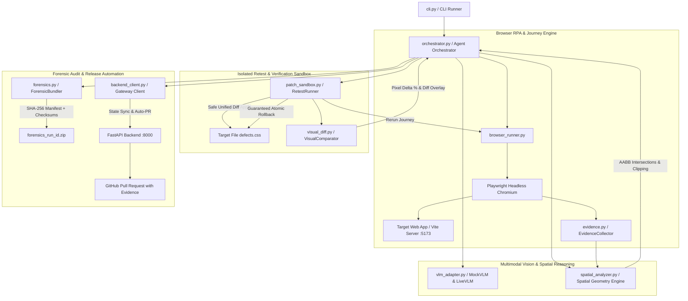
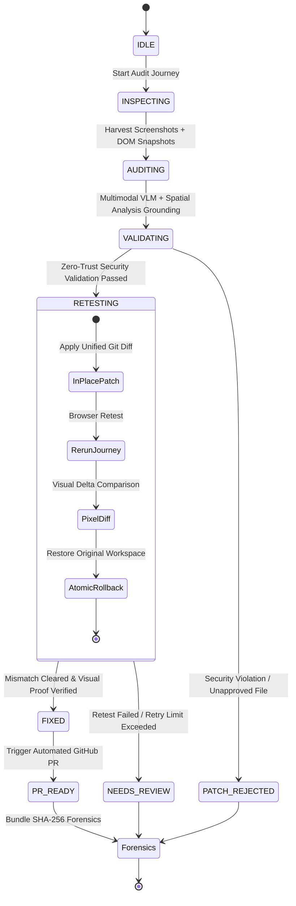
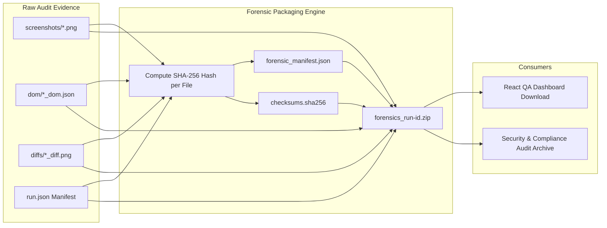

# OmniSight Browser Automation, RPA & Visual Self-Healing Engine

> Headless Playwright Multi-Viewport Navigation, Pure-Python Spatial Geometry Analysis, Isolated Sandbox Retesting with Atomic Rollback, and Cryptographic Forensic Bundling.

[](https://www.python.org/)
[](https://playwright.dev/)
[](https://python-pillow.org/)
[](https://docs.pydantic.dev/)
[](https://pytest.org/)
[](https://en.wikipedia.org/wiki/SHA-2)

---

## 📋 Overview

The **OmniSight Automation Engine** is the autonomous RPA (Robotic Process Automation) and visual intelligence core of the OmniSight platform. While standard test frameworks (Selenium, Cypress, Playwright assertions) verify whether DOM elements exist in code, they cannot detect whether elements are **visually functional, readable, unclipped, or non-overlapping**.

OmniSight bridges this gap through an autonomous, closed-loop visual QA agent that:
1. **Navigates Real User Journeys**: Drives headless Chromium through multi-page e-commerce flows (Home &rarr; Cart &rarr; Checkout) across responsive viewports.
2. **Harvests Multimodal Evidence**: Captures full-resolution before/after screenshots, bounding-box geometry, DOM structural trees, and console/network logs.
3. **Grounds Visual AI with Deterministic Geometry**: Combines Vision-Language Models (VLMs) with a pure-Python Axis-Aligned Bounding Box (AABB) spatial analyzer to detect clipping, collisions, and occlusions without hallucinations.
4. **Validates & Sandboxes Patches**: Applies proposed CSS fixes in an isolated sandbox with **guaranteed atomic rollback**, preventing side effects on the live codebase.
5. **Performs Pixel Delta Diffing**: Re-runs the exact user journey against the patched sandbox to generate visual pixel diffs and calculate exact mismatch percentages.
6. **Compiles Cryptographic Forensic Bundles**: Generates tamper-evident ZIP archives containing SHA-256 manifests (`forensic_manifest.json`, `checksums.sha256`) for enterprise compliance and auditability.
7. **Synchronizes with Gateway & Opens PRs**: Streams run state transitions to the FastAPI gateway and automatically opens evidence-backed GitHub Pull Requests upon verified remediation.

---

## ⚡ Core Capabilities & Milestones

| Capability | Scope | Status | Architecture Highlights |
| :--- | :--- | :---: | :--- |
| **Browser RPA** | Multi-Viewport Automation | ✅ Production | Playwright Chromium runner, responsive matrix (`1440×900`, `1280×800`, `390×844`, `375×667`), store health probe, screenshot/DOM capture journey. |
| **Spatial Geometry** | Pure-Python Layout Analysis | ✅ Production | Axis-aligned bounding box engine (`BoundingBox`, IoU, clipping, collision, occlusion), eliminates VLM hallucinations with DOM coordinates. |
| **Isolated Sandbox** | Safe Retest & Rollback | ✅ Production | Zero-trust allowlist validator, unified git diff parser, and hot-reload retesting with guaranteed atomic rollback in `finally` block. |
| **Visual Diffing** | Pixel Delta Comparator | ✅ Production | `VisualComparator` with per-channel color tolerance, sub-pixel mismatch calculation, and diagnostic magenta bounding-box diff overlays. |
| **Release & Forensics** | PR Engine & Forensics | ✅ Production | End-to-end closed-loop orchestrator, FastAPI gateway sync, automated PR dispatch, and SHA-256 cryptographic compliance bundling. |

---

## 🏛️ System Architecture

### 1. Component Topology



---

### 2. Closed-Loop State Machine Lifecycle



---

### 3. Cryptographic Forensic Audit Pipeline



---

## 🧩 Subsystem Deep Dive & Component Catalog

### 1. `browser_runner.py` — Multi-Viewport Journey Automation
* **Purpose**: Coordinates headless Playwright execution across standard responsive viewports.
* **Core Functions**:
  * `check_store_health(app_url, timeout)`: Probes target store URL with automatic IPv6 localhost and port fallback (`5173`, `5174`, `5175`). Confirms that the target returns an HTTP 200 containing expected application markers (`everyday` or `root`).
  * `launch_browser()`: Context manager launching headless Chromium with optimal sandboxing flags (`--no-sandbox`, `--disable-dev-shm-usage`).
  * `run_visual_audit_journey(app_url, run_id, scenario, viewports)`: Executes a complete multi-step journey (Home &rarr; Cart &rarr; Checkout), capturing high-resolution viewport screenshots and serialized DOM geometry at every step.
  * **Console & Network Error Listeners**: Intercepts unhandled JavaScript runtime exceptions, failed HTTP requests, and console warnings into the run evidence.

### 2. `spatial_analyzer.py` — DOM Spatial Geometry Engine
* **Purpose**: Pure Python layout geometry engine computing physical intersections and boundary violations. Eliminates VLM hallucinations by anchoring visual findings in ground-truth DOM coordinates.
* **Key Classes & Methods**:
  * `BoundingBox`: Frozen dataclass representing axis-aligned bounding boxes (AABB) with properties `left`, `top`, `right`, `bottom`, `area`, `intersects()`, `intersection()`, and `iou()` (Intersection over Union).
  * `SpatialAnalyzer.detect_clipping(element, viewport)`: Identifies elements exceeding viewport width/height (e.g., button clipped on mobile).
  * `SpatialAnalyzer.detect_collisions(elements)`: Finds overlapping interactive or text elements (e.g., hero heading colliding with product grid).
  * `SpatialAnalyzer.detect_occlusions(elements)`: Detects action-blocking elements occluding primary buttons (e.g., promo banner covering checkout button).
  * `SpatialAnalyzer.to_findings(anomalies, viewport_name)`: Maps spatial anomalies directly into standardized `Finding` schema models.

### 3. `vlm_adapter.py` — Multimodal Visual AI Adapters
* **Purpose**: Translates visual screenshots and DOM structures into structured defect reports and proposed code patches.
* **Key Classes**:
  * `BaseVLMAdapter`: Abstract base interface defining `audit_viewports(...) -> VisualAuditReport`.
  * `MockVLMAdapter`: Deterministic offline adapter implementing the Infotact baseline specification. Reliably identifies seeded visual defects in the target store (Defect 1: heading overlap; Defect 2: button clipped; Defect 3: submit obstructed) and synthesizes corresponding minimal unified git diffs.
  * `LiveVLMAdapter`: Production adapter calling live multimodal APIs (Gemini 1.5 Pro / GPT-4o / Claude 3.5 Sonnet) with prompt templates stored in `automation/prompts/`.

### 4. `patch_sandbox.py` — Zero-Trust Retest Sandbox
* **Purpose**: Safely applies proposed fixes to the live workspace, executes hot-reload retesting, and guarantees atomic rollback.
* **Security & Execution Guardrails**:
  * `ALLOWED_PATCH_TARGETS`: Restricts patch application strictly to approved CSS and component files (`app-under-test/src/styles/defects.css`, `base.css`, `App.css`, `index.css`, `components/`, `App.jsx`).
  * `validate_patch_target(path)`: Rejects path traversal (`..`), absolute paths, or unapproved targets.
  * `apply_unified_diff(original_text, diff_text)`: Deterministic in-memory diff engine supporting standard hunk headers (`@@ -L,N +L,N @@`) and headerless patch chunks.
  * `RetestRunner.verify_patch(target_file, diff, target_viewport, ...)`:
    1. Reads original file content.
    2. Writes patched content to disk.
    3. Re-runs browser journey at the affected viewport.
    4. Computes visual pixel diff against the baseline screenshot.
    5. **Guaranteed Rollback**: A `finally:` block restores the original file content immediately, guaranteeing zero side effects on the working tree.

### 5. `visual_diff.py` — Pixel Delta Diff & Screenshot Annotation
* **Purpose**: Computes pixel-level differences between before and after screenshots, generating visual proof overlays.
* **Key Classes & Methods**:
  * `VisualComparator(tolerance=15)`: Per-channel threshold (0–255) below which minor anti-aliasing variations are ignored.
  * `compare_images(before_path, after_path, diff_output_path) -> DiffResult`: Uses `PIL.ImageChops.difference` to compute exact mismatch percentages, identify changed bounding boxes, and generate high-contrast magenta pixel diff images.
  * `annotate_defects(image_path, bounding_boxes, output_path)`: Draws defect bounding boxes, warning labels, and confidence metrics directly onto screenshots for human review.

### 6. `forensics.py` — Cryptographic Audit Bundling Engine
* **Purpose**: Consolidates run artifacts into an immutable, tamper-evident audit bundle.
* **Key Components**:
  * `compute_sha256(path)`: Streams binary chunks (64KB) to calculate cryptographic SHA-256 digests.
  * `ForensicBundler.bundle_run(run_id, run_dir, run_data)`:
    1. Discovers all run artifacts (screenshots, DOM JSONs, diffs, logs, `run.json`).
    2. Generates `checksums.sha256` (standard GNU Coreutils format: `<hash>  <relative_path>`).
    3. Compiles `forensic_manifest.json` with file sizes, timestamps, and hash mappings.
    4. Compresses all assets into `forensics_<run_id>.zip` with standard `ZIP_DEFLATED` compression.

### 7. `orchestrator.py` — Closed-Loop State Machine
* **Purpose**: Central coordinator executing the `Inspect` &rarr; `Audit` &rarr; `Validate` &rarr; `Retest` &rarr; `Evaluate` &rarr; `PR` &rarr; `Forensics` pipeline.
* **Key Features**:
  * `AgentState` transitions (`IDLE`, `INSPECTING`, `AUDITING`, `VALIDATING`, `RETESTING`, `FIXED`, `NEEDS_REVIEW`, `PR_READY`).
  * **Bounded Retries**: Strictly capped (`max_retries=1`) to prevent runaway recursive execution.
  * **Evidence Synchronization**: Automatically updates `evidence_paths` with baseline screenshots, after screenshots, and visual diffs.
  * **Backend Client Integration**: Sends lifecycle updates to FastAPI gateway when `--sync-backend` is active.

### 8. `backend_client.py` — FastAPI Gateway Client
* **Purpose**: Bi-directional HTTP client connecting the automation orchestrator to the backend service.
* **Supported Operations**:
  * `create_run(...)` / `update_run_state(...)`: Notifies gateway of run initialization, progress, findings, and evidence.
  * `parse_vlm_output(...)`: Calls `/action-engine/parse` to extract and validate patches.
  * `submit_patch_for_pr(...)`: Triggers `/runs/{run_id}/create-pr` to open an automated GitHub PR.
  * `generate_forensics(...)` / `get_forensics(...)`: Coordinates forensic bundle generation and metadata retrieval.

### 9. `evidence.py` — Artifact & Directory Manager
* **Purpose**: Manages localized session directories and standardized JSON manifests.
* **Key Classes**:
  * `EvidenceCollector`: Organizes per-run artifact folders (`screenshots/`, `dom/`, `diffs/`).
  * `RunManifest`: Generates `run.json` containing run metadata, environment info (OS, Python version), viewport list, issue count, and execution timestamps.
  * `extract_dom_context(page)`: Injects browser-side JavaScript to extract geometry (bounding boxes, tags, IDs, class names) of key interactive elements.

### 10. `cli.py` — Unified Command-Line Interface
* **Purpose**: Provides a single-command CLI entrypoint with flexible configuration flags for developers, CI pipelines, and automated jobs.

---

## 🔄 The 6-Step Closed-Loop Execution Flow

```
[1. HEALTH PROBE]    Validate target store availability (http://localhost:5173)
        │
[2. JOURNEY RPA]     Playwright drives Home -> Cart -> Checkout across Desktop & Mobile
        │            Captures: screenshots/*_before.png, dom/*_dom.json
        │
[3. VLM & SPATIAL]   VLM reasoning + DOM spatial geometry grounding
        │            Produces: VisualAuditReport with structured findings & CSS diff
        │
[4. ZERO-TRUST]      Security check: file allowlist, path traversal, script injection
        │
[5. ISOLATED RETEST] In-place patch -> hot retest -> visual pixel diff -> atomic rollback
        │            Produces: *_after.png, *_diff.png, mismatch percentage
        │
[6. RELEASE & AUDIT] Open GitHub PR with visual proof + compile SHA-256 forensic ZIP
```

---

## 📱 Standard Responsive Viewport Specifications

OmniSight evaluates layouts across 4 standard viewports defined in `automation/config.py`:

| Viewport Identifier | Resolution | Scale Factor | Mobile / Touch | Target Device Profile |
| :--- | :---: | :---: | :---: | :--- |
| `desktop_1440x900` | 1440 × 900 | 1.0x | ❌ No | Standard widescreen desktop monitor |
| `desktop_1280x800` | 1280 × 800 | 1.0x | ❌ No | Standard laptop display resolution |
| `mobile_390x844` | 390 × 844 | 3.0x | ✅ Yes | Modern flagship mobile (iPhone 12/13/14) |
| `mobile_375x667` | 375 × 667 | 2.0x | ✅ Yes | Compact mobile device (iPhone SE / narrow screens) |

---

## 📁 Artifact Storage & Directory Hierarchy

Every audit run generates a self-contained, reproducible evidence directory under `artifacts/runs/<run_id>/`:

```
artifacts/runs/run-1730000000/
├── screenshots/
│   ├── desktop_1440x900_home_before.png
│   ├── desktop_1440x900_cart_before.png
│   ├── desktop_1440x900_checkout_before.png
│   ├── desktop_1440x900_home_after.png
│   ├── desktop_1440x900_home_annotated.png
│   ├── mobile_375x667_checkout_before.png
│   └── mobile_375x667_checkout_after.png
├── dom/
│   ├── desktop_1440x900_home_dom.json
│   ├── desktop_1440x900_cart_dom.json
│   └── mobile_375x667_checkout_dom.json
├── diffs/
│   ├── desktop_1440x900_home_diff.png
│   └── mobile_375x667_checkout_diff.png
├── run.json                         # Standardized run metadata & findings
├── forensic_manifest.json           # File metadata, sizes, and SHA-256 hashes
├── checksums.sha256                 # GNU Coreutils compatible checksum manifest
└── forensics_run-1730000000.zip     # Immutable, standalone compliance archive
```

---

## 💻 CLI Usage Reference & Command Cookbook

### CLI Arguments

| Flag | Type | Default | Description |
| :--- | :---: | :---: | :--- |
| `--target` | `str` | `http://127.0.0.1:5173` | Target web application base URL |
| `--scenario` | `str` | `checkout_flow` | Target journey scenario to execute |
| `--viewports` | `list` | Standard 4 viewports | Specific viewports (e.g., `desktop_1440x900 mobile_375x667`) |
| `--use-live-vlm` | `flag` | `False` (Mock VLM) | Call live multimodal API instead of deterministic mock |
| `--no-retest` | `flag` | `False` | Skip sandboxed retest verification |
| `--auto-pr` | `flag` | `False` | Automatically open Pull Request upon verified remediation |
| `--bundle-forensics`| `flag` | `False` | Compile cryptographic forensic ZIP bundle with SHA-256 |
| `--sync-backend` | `flag` | `False` | Synchronize run state and findings with FastAPI gateway |
| `--backend-url` | `str` | `http://127.0.0.1:8000` | FastAPI gateway base URL |
| `--json-output` | `flag` | `False` | Format stdout strictly as JSON for pipeline ingestion |

---

### Command Recipes

#### 1. Quick Standalone Local Audit
Runs browser navigation and VLM audit with offline mock adapter:
```bash
python -m automation.cli --target http://localhost:5173
```

#### 2. Closed-Loop Audit with Sandboxed Retest & Forensics
Performs audit, applies patch in sandbox, verifies fix via visual diff, and generates cryptographic bundle:
```bash
python -m automation.cli --target http://localhost:5173 --bundle-forensics
```

#### 3. Full Autonomous Closed Loop with Backend Sync & Auto-PR
Connects to FastAPI gateway, syncs state, verifies fix, opens GitHub PR, and bundles forensics:
```bash
python -m automation.cli \
  --target http://localhost:5173 \
  --sync-backend \
  --auto-pr \
  --bundle-forensics
```

#### 4. Targeted Mobile Viewport Audit
Restricts journey execution specifically to mobile viewports:
```bash
python -m automation.cli \
  --target http://localhost:5173 \
  --viewports mobile_390x844 mobile_375x667 \
  --bundle-forensics
```

#### 5. Headless JSON Output for CI/CD Pipelines
Outputs machine-parseable JSON report directly to stdout:
```bash
python -m automation.cli --target http://localhost:5173 --json-output > audit_results.json
```

---

## ⚙️ Environment Configuration

Configuration is loaded from environment variables (or `.env` file) via `automation/config.py`:

| Variable | Type | Default | Description |
| :--- | :---: | :---: | :--- |
| `APP_URL` | `str` | `http://127.0.0.1:5173` | Target web app URL |
| `BACKEND_URL` | `str` | `http://127.0.0.1:8000` | FastAPI gateway URL |
| `VLM_API_KEY` | `str` | _None_ | Multimodal VLM API key (Gemini / OpenAI / Anthropic) |
| `HEADLESS` | `bool` | `true` | Run Chromium in headless mode |
| `NAVIGATION_TIMEOUT_MS` | `int` | `15000` | Page navigation timeout in milliseconds |
| `ACTION_TIMEOUT_MS` | `int` | `5000` | Click and input action timeout in milliseconds |
| `HEALTH_CHECK_TIMEOUT_S` | `float` | `3.0` | Target store health check timeout in seconds |

---

## 🧪 Test Matrix & Verification

The automation subsystem includes **46 automated tests** in `automation/tests/` covering every component of the RPA and remediation loop:

```bash
# Run full automation test suite
python -m pytest automation/tests/ -v
```

### Test Suite Breakdown

| Test File | Tests | Coverage Scope |
| :--- | :---: | :--- |
| [`test_forensics.py`](file:///automation/tests/test_forensics.py) | 3 | SHA-256 calculation, manifest structure, ZIP archive extraction & verification. |
| [`test_retest_sandbox.py`](file:///automation/tests/test_retest_sandbox.py) | 10 | Unified diff parsing, allowlist security enforcement, path traversal rejection, atomic rollback in `finally` block. |
| [`test_spatial_and_diff.py`](file:///automation/tests/test_spatial_and_diff.py) | 9 | `BoundingBox` AABB intersection, IoU calculation, viewport clipping, element collision, z-index occlusion, `VisualComparator` pixel delta tolerance. |
| [`test_backend_integration.py`](file:///automation/tests/test_backend_integration.py) | 18 | `BackendClient` fail-fast probing, state syncing, Action Engine VLM parsing, PR creation endpoint, forensic generation, evidence synchronization. |
| [`test_closed_loop_e2e.py`](file:///automation/tests/test_closed_loop_e2e.py) | 1 | Complete end-to-end simulation: Inspection &rarr; Spatial Grounding &rarr; Sandboxed Retest &rarr; Visual Diff &rarr; Auto-PR &rarr; Forensic Bundling. |
| [`test_config_and_viewports.py`](file:///automation/tests/test_config_and_viewports.py) | 3 | Viewport dimensions, scale factors, mobile/touch flag configurations, unknown viewport error handling. |
| [`test_vlm_pipeline.py`](file:///automation/tests/test_vlm_pipeline.py) | 2 | Mock VLM deterministic output, finding schemas, patch structure. |

### Run the Closed-Loop Verification Demo
A dedicated end-to-end verification script runs the complete 5-step closed-loop lifecycle:
```bash
python scripts/demo_week3_closed_loop.py
```
This script exercises:
1. Target store health verification
2. Multi-viewport browser journey execution
3. Multimodal VLM audit with spatial geometry analysis
4. Isolated sandbox retest with visual diffing and atomic rollback
5. Automated PR trigger and cryptographic forensic packaging
