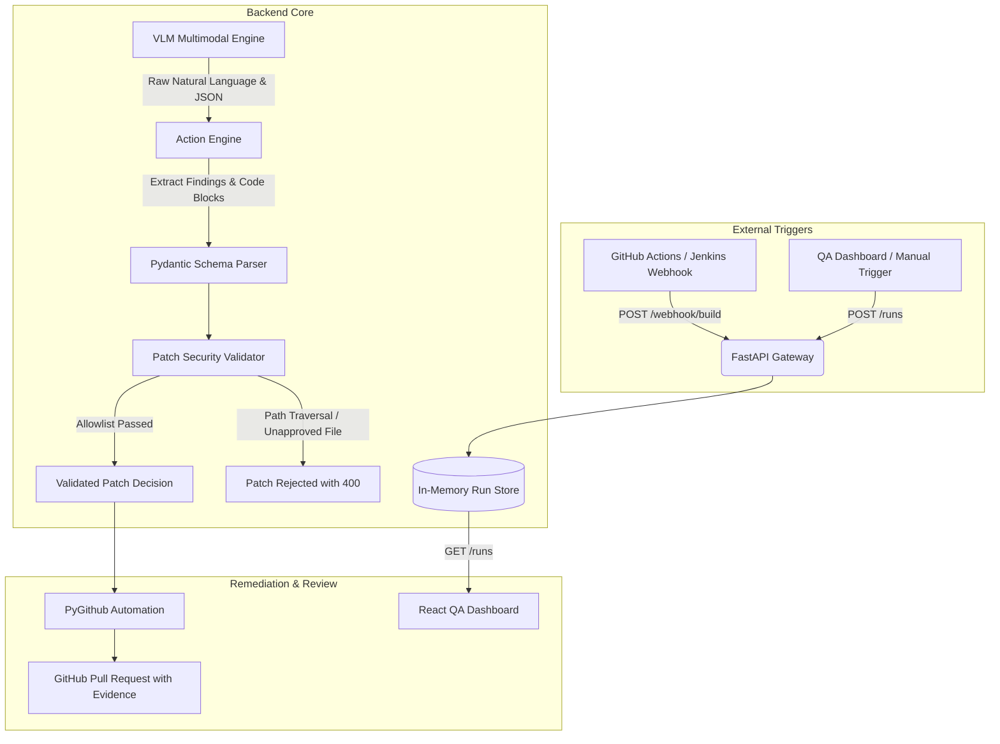

# OmniSight Backend Gateway & Action Engine

> **Member 1 Ownership**: FastAPI CI/CD Gateway, Action Engine, Zero-Trust Patch Validator, and GitHub Pull Request Automation.

[](https://fastapi.tiangolo.com/)
[](https://docs.pydantic.dev/)
[](https://pytest.org/)
[](https://www.terraform.io/)

---

## 📋 Overview

The OmniSight Backend service acts as the central intelligence and security clearinghouse for the autonomous visual self-healing loop:
1. **CI/CD Gateway (`/webhook/build`)**: Ingests build events from external CI/CD pipelines (or manual QA triggers) and schedules browser audit runs.
2. **Action Engine (`/action-engine/parse`)**: Parses multimodal Vision-Language Model (VLM) outputs, extracting structured findings, rationale, confidence scores, and unified git diff code patches from natural language and markdown code blocks.
3. **Zero-Trust Patch Validator**: Verifies that proposed fixes conform to strict security allowlists, rejecting path traversals (`..`), URL-encoded traversal (`%2e%2e`), null bytes, absolute paths, unauthorized file modifications, oversized diffs, and script injection payloads.
4. **GitHub PR Automation**: Once a patch passes automated re-testing in an isolated sandbox, creates a feature branch, commits the approved changes, and opens an evidence-backed Pull Request.

---

## 🗓️ Weekly Milestones (Member 1)

| Period | Milestone | Status | Details |
| :--- | :--- | :---: | :--- |
| **Week 1** | Foundation & API Scaffolding | ✅ Completed | FastAPI service, `/health`, `/webhook/build`, `/runs`, `/runs/{run_id}`, shared Pydantic data schemas. |
| **Week 2 (Day 1-2)** | Action Engine & Security Validator | ✅ Completed | Multimodal JSON/diff extractor (`action_engine.py`), path traversal defense, allowlist checks, script injection filters, 40 unit/integration tests. |
| **Week 2 (Day 3-5)** | Mid-Project Review & Integration | ✅ Completed | Extraction check verified, sandbox retest coordination with Team Lead & Member 2, end-to-end integration verified. |
| **Week 3** | Bounded Self-Healing & PR Engine | ⏳ In Progress | Branch, commit, and PR creation via PyGithub with mock fallbacks for offline testing. |
| **Week 4** | Production Hardening & Cloud Deploy | ⏳ Planned | Containerized deployment and cloud infrastructure. |

---

## 🏛️ System Architecture



---

## 🔒 Security Guardrails & Zero-Trust Architecture

To ensure the AI cannot harm repository integrity or internal network services, the backend enforces the following controls:

1. **SSRF Protection (`_validate_target_host`)**:
   Incoming target URLs are checked against `ALLOWED_TARGET_HOSTS` (`localhost`, `127.0.0.1`, `staging.internal`). Unapproved external hosts are rejected with HTTP 400.
2. **Strict File Allowlist**:
   Patches can ONLY modify approved styling and component files:
   * `app-under-test/src/styles/defects.css`
   * `app-under-test/src/styles/base.css`
   * `app-under-test/src/components/` (`.jsx`, `.js`, `.css`)
   * `app-under-test/src/App.jsx`
   Any attempt to modify server code (`backend/app/main.py`), configs (`package.json`), or root files is immediately rejected.
3. **Path Traversal Defense**:
   Target file paths containing `..`, absolute indicators (`/`, `C:\`), or backslashes are blocked.
4. **Script & Code Injection Defense**:
   Diff contents are scanned for malicious script signatures:
   * `<script`, `javascript:`, `expression(`, `eval(`, `exec(`, `onerror=`, `onload=`, `document.cookie`.
5. **Diff Size Boundaries**:
   Diffs exceeding 300 lines or 30KB are rejected to prevent runaway code overwrites.

---

## 📡 API Reference

### 1. Health Check
* **Endpoint**: `GET /health`
* **Response (200 OK)**:
  ```json
  {
    "status": "healthy",
    "timestamp": "2026-10-22T12:00:00Z",
    "version": "1.0.0"
  }
  ```

### 2. CI/CD Build Webhook
* **Endpoint**: `POST /webhook/build`
* **Request**:
  ```json
  {
    "target_url": "http://localhost:5173",
    "branch": "main",
    "scenario": "checkout_flow",
    "commit_sha": "56e42d7f",
    "event_id": "evt-1001"
  }
  ```
* **Response (202 Accepted)**:
  ```json
  {
    "run_id": "run-1729418400",
    "status": "queued",
    "message": "Build event accepted and queued for browser audit."
  }
  ```

### 3. Manual Audit Trigger
* **Endpoint**: `POST /runs`
* **Request**:
  ```json
  {
    "target_url": "http://localhost:5173",
    "scenario": "checkout_flow",
    "viewports": ["desktop_1440x900", "mobile_375x667"]
  }
  ```
* **Response (201 Created)**:
  ```json
  {
    "run_id": "run-1729418400",
    "status": "running"
  }
  ```

### 4. Action Engine VLM Parser
* **Endpoint**: `POST /action-engine/parse`
* **Request**:
  ```json
  {
    "raw_vlm_output": "The checkout button is clipped on mobile viewports. ```json\n{\n  \"findings\": [ ... ],\n  \"proposed_patch\": { \"target_file\": \"app-under-test/src/styles/defects.css\", \"diff\": \"...\" }\n}\n```"
  }
  ```
* **Response (200 OK)**:
  ```json
  {
    "is_valid": true,
    "findings": [
      {
        "id": "defect-1",
        "category": "element_clipping",
        "severity": "high",
        "description": "Place Order button clipped on mobile",
        "viewport": "mobile_375x667",
        "confidence": 0.94,
        "suggested_change": "width: 100%",
        "rationale": "Bounding box extends past viewport right boundary",
        "status": "detected"
      }
    ],
    "proposed_patch": {
      "target_file": "app-under-test/src/styles/defects.css",
      "diff": "-.btn { width: 500px; }\n+.btn { width: 100%; }",
      "validation_status": true,
      "validator_errors": null
    },
    "validation_status": true,
    "validator_errors": null,
    "parse_errors": []
  }
  ```

### 5. Submit and PR Validated Patch
* **Endpoint**: `POST /runs/{run_id}/submit-patch`
* **Request**:
  ```json
  {
    "target_file": "app-under-test/src/styles/defects.css",
    "diff": "-.btn { width: 500px; }\n+.btn { width: 100%; }",
    "file_content": ".btn { width: 100%; }",
    "pr_title": "fix(ui): repair mobile checkout button clipping",
    "pr_body": "Automated patch verified by sandbox re-test."
  }
  ```
* **Response (200 OK)**:
  ```json
  {
    "status": "success",
    "pr_url": "https://github.com/Kailash-18/OmniSight/pull/12"
  }
  ```

---

## 🛠️ Environment Configuration & Zero Hardcoding

Credentials and settings are managed through environment variables. **No API keys or tokens are hardcoded into the source code.**

Copy `.env.example` to `backend/.env`:
```bash
cp backend/.env.example backend/.env
```

| Variable | Type | Description | Default |
| :--- | :--- | :--- | :--- |
| `GITHUB_TOKEN` | string | GitHub fine-grained PAT (Contents: R/W, Pull Requests: R/W) | _None_ |
| `REPO_NAME` | string | Target repository name | `Kailash-18/OmniSight` |
| `MOCK_GITHUB` | bool | When `true`, simulates PR creation without making live GitHub calls | `false` |
| `ALLOWED_TARGET_HOSTS` | string | Comma-separated allowed hostnames for audit runs | `localhost,127.0.0.1,staging.internal` |
| `ALLOWED_PATCH_FILES` | string | Comma-separated allowed patch target files/paths | `app-under-test/src/styles/defects.css,...` |
| `BACKEND_PORT` | int | Server port | `8000` |

---

## ☁️ Cloud Infrastructure (Week 4 Milestone)

Infrastructure definitions for deploying the containerized backend gateway to AWS App Runner / ECS are staged in `backend/terraform/` for Week 4 deliverables:
* Zero hardcoded credentials; all parameters and sensitive GitHub PATs are managed via environment variables and `.tfvars` excluded by `.gitignore`.
* Production containerization will package FastAPI, Uvicorn, and health endpoints.

---

## 🧪 Running the Backend & Tests

### 1. Install Dependencies
```bash
pip install -r backend/requirements.txt
```

### 2. Start the Backend API Server
```bash
uvicorn app.main:app --app-dir backend --reload --port 8000
```
Interactive Swagger docs: `http://localhost:8000/docs`

### 3. Run Backend Test Suite
```bash
python -m pytest backend/tests/ -v
```
All **40 backend tests** verify Action Engine parsing, patch allowlist validation, path traversal defense, script injection resistance, idempotency, milestone reporting, and API endpoints.

### 4. Quick API Smoke Test via cURL
```bash
# Health check
curl -X GET http://localhost:8000/health

# Trigger simulated build webhook
curl -X POST http://localhost:8000/webhook/build \
  -H "Content-Type: application/json" \
  -d '{"target_url":"http://localhost:5173","branch":"main","scenario":"checkout_flow"}'

# List active runs
curl -X GET http://localhost:8000/runs
```


