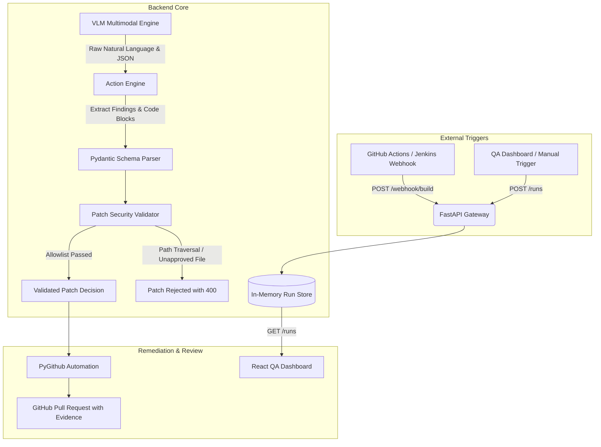

# OmniSight Backend Gateway & Action Engine

> **Member 1 Ownership**: FastAPI CI/CD Gateway, Action Engine, Zero-Trust Patch Validator, and GitHub Pull Request Automation.

[](https://www.python.org/)
[](https://fastapi.tiangolo.com/)
[](https://docs.pydantic.dev/)
[](https://pytest.org/)
[](https://www.terraform.io/)


---

## 📋 Overview

The OmniSight Backend service acts as the central intelligence and security clearinghouse for the autonomous visual self-healing loop:
1. **CI/CD Gateway (`/webhook/build`)**: Ingests build events from external CI/CD pipelines (or manual QA triggers) and schedules browser audit runs.
2. **Action Engine (`/action-engine/parse`)**: Parses multimodal Vision-Language Model (VLM) outputs, extracting structured findings, rationale, confidence scores, and unified git diff code patches from natural language, markdown code blocks, single-quoted JSON dicts, and smart quotes.
3. **Zero-Trust Patch Validator**: Verifies that proposed fixes conform to strict security allowlists, rejecting path traversals (`..`), URL-encoded traversal (`%2e%2e`), null bytes (`\x00`), absolute paths, unauthorized file modifications, oversized diffs, script injection payloads, CSS expressions, and dangerous URI schemes.
4. **GitHub PR Automation**: Once a patch passes automated re-testing in an isolated sandbox, creates a feature branch, commits the approved changes, and opens an evidence-backed Pull Request.
5. **Retest Synchronization & Forensics**: Synchronizes sandbox retest verification proofs, updates PR review comments with visual diff scores, logs chronological execution timelines, and exports forensic compliance archives.

---

## 📦 Core Modules & Engineering Deliverables (Member 1)

| Module | Core Responsibility | Status | Technical Implementation |
| :--- | :--- | :---: | :--- |
| **API Gateway & Ingestion Engine** | Foundation & API Scaffolding | ✅ Completed | FastAPI service, `/health`, `/webhook/build`, `/webhook/github`, `/runs`, `/runs/metrics/summary`, shared Pydantic data schemas. |
| **Multimodal Action Engine** | VLM Parsing & Code Block Extraction | ✅ Completed | Multimodal JSON/diff extractor (`action_engine.py`), single-quote & smart-quote recovery, natural language isolation, and structured findings. |
| **Zero-Trust Security Validator** | Safe Code Modification Guardrails | ✅ Completed | Path traversal defense, allowlist checks, CSS directive filters (`@import`, `behavior`, `expression`, `javascript:`), and 97 passing tests. |
| **Pull Request Automation Service** | Bounded Self-Healing & Evidence PRs | ✅ Completed | Automated PR creation, PR labeling, lifecycle webhook tracking, retest comments, and markdown evidence export. |
| **Retest Sync & Forensic Engine** | Verification Sync & Compliance Logs | ✅ Completed | Retest result ingestion (`/runs/{run_id}/retest-result`), PR proof updater, event timeline, finding status patch, and forensic JSON bundle. |
| **Cloud Infrastructure as Code** | Production Hardening & Cloud Deploy | ✅ Prepared | Terraform parameterized infrastructure module (`backend/terraform/`) with zero hardcoded credentials. |


---

## 🏛️ System Architecture



---

## 🔒 Security Guardrails & Zero-Trust Architecture

To ensure the AI cannot harm repository integrity or internal network services, the backend enforces the following controls:

1. **SSRF Protection (`_validate_target_host`)**:
   Incoming target URLs are checked against `ALLOWED_TARGET_HOSTS` (`localhost`, `127.0.0.1`, `0.0.0.0`, `::1`, `staging.internal`). Unapproved external hosts are rejected with HTTP 400.
2. **Strict File Allowlist**:
   Patches can ONLY modify approved styling and component files:
   * `app-under-test/src/styles/defects.css`
   * `app-under-test/src/styles/base.css`
   * `app-under-test/src/App.css`
   * `app-under-test/src/index.css`
   * `app-under-test/src/components/` (`.jsx`, `.js`, `.css`)
   * `app-under-test/src/App.jsx`
   Any attempt to modify server code (`backend/app/main.py`), configs (`package.json`), or root files is immediately rejected.
3. **Path Traversal Defense**:
   Target file paths containing `..`, `%2e%2e`, absolute indicators (`/`, `C:\`), or backslashes are blocked.
4. **Script & Code Injection Defense**:
   Diff contents and whole file payloads are scanned for malicious script signatures:
   * `<script`, `javascript:`, `expression(`, `eval(`, `exec(`, `onerror=`, `onload=`, `document.cookie`.
5. **Diff Size Boundaries**:
   Diffs exceeding 300 lines or 30KB are rejected to prevent runaway code overwrites.

---

## 📡 API Reference

### 1. Health Check
* **Endpoint**: `GET /health`
* **Response (200 OK)**:
  ```json
  {
    "status": "healthy",
    "timestamp": "2026-10-22T12:00:00Z",
    "version": "1.0.0"
  }
  ```

### 2. System Milestone Tracker & Security Boundaries
* **Endpoint**: `GET /api/milestones`
* **Response (200 OK)**:
  ```json
  {
    "member": "Member 1 - Backend & PR Automation",
    "foundation_scaffolding": "completed",
    "action_engine_and_security": "completed",
    "system_integration": "completed",
    "pr_automation_engine": "ready",
    "allowed_targets": ["localhost", "127.0.0.1", "0.0.0.0", "::1", "staging.internal"],
    "allowed_patch_files": ["app-under-test/src/styles/defects.css", "..."]
  }
  ```

### 3. CI/CD Build Webhook
* **Endpoint**: `POST /webhook/build`
* **Request**:
  ```json
  {
    "target_url": "http://localhost:5173",
    "branch": "main",
    "scenario": "checkout_flow",
    "commit_sha": "56e42d7f",
    "event_id": "evt-1001"
  }
  ```
* **Response (202 Accepted)**:
  ```json
  {
    "run_id": "run-1729418400-a1b2c3",
    "status": "queued",
    "message": "Build event accepted and queued for browser audit."
  }
  ```

### 4. Manual Audit Trigger
* **Endpoint**: `POST /runs`
* **Request**:
  ```json
  {
    "target_url": "http://localhost:5173",
    "scenario": "checkout_flow",
    "viewports": ["desktop_1440x900", "mobile_375x667"]
  }
  ```
* **Response (201 Created)**:
  ```json
  {
    "run_id": "run-1729418400-a1b2c3",
    "status": "running"
  }
  ```

### 5. List Recorded Audit Runs (With Filtering & Pagination)
* **Endpoint**: `GET /runs?limit=50&status_filter=queued`
* **Query Parameters**:
  * `limit` (int, default 50): Maximum number of run summaries to return.
  * `status_filter` (string, optional): Filter by lifecycle status (`queued`, `running`, `audited`, `fixed`, `pr_opened`, etc.).
* **Response (200 OK)**:
  Returns run summaries sorted in reverse chronological order.

### 6. Get Comprehensive Audit Run Details
* **Endpoint**: `GET /runs/{run_id}`
* **Response (200 OK)**:
  ```json
  {
    "run_id": "run-1729418400-a1b2c3",
    "start_time": "2026-10-22T12:00:00Z",
    "target": "http://localhost:5173",
    "status": "audited",
    "steps": ["initiate_browser_session", "capture_viewport_screenshot"],
    "evidence_paths": {
      "mobile_375x667": "artifacts/runs/run-1729418400-a1b2c3/mobile.png"
    },
    "findings": [
      {
        "id": "defect-1",
        "category": "element_clipping",
        "severity": "high",
        "description": "Place Order button clipped on mobile",
        "viewport": "mobile_375x667",
        "confidence": 0.94,
        "suggested_change": "width: 100%",
        "rationale": "Bounding box extends past viewport right boundary",
        "status": "detected"
      }
    ],
    "patch": {
      "target_file": "app-under-test/src/styles/defects.css",
      "diff": "-.btn { width: 500px; }\n+.btn { width: 100%; }",
      "validation_status": true,
      "validator_errors": null
    },
    "retry_count": 0,
    "pr_url": null,
    "error": null
  }
  ```

### 7. Update Audit Run Record State
* **Endpoint**: `PUT /runs/{run_id}`
* **Request**:
  ```json
  {
    "status": "audited",
    "steps": ["initiate_browser_session", "vlm_analysis_completed"],
    "findings": [ ... ],
    "patch": { ... }
  }
  ```
* **Response (200 OK)**:
  ```json
  {
    "message": "Run 'run-1729418400-a1b2c3' updated successfully.",
    "status": "audited"
  }
  ```

### 8. Action Engine VLM Parser
* **Endpoint**: `POST /action-engine/parse`
* **Request**:
  ```json
  {
    "raw_vlm_output": "The checkout button is clipped on mobile viewports. ```json\n{\n  \"findings\": [ ... ],\n  \"proposed_patch\": { \"target_file\": \"app-under-test/src/styles/defects.css\", \"diff\": \"...\" }\n}\n```"
  }
  ```
* **Response (200 OK)**:
  ```json
  {
    "is_valid": true,
    "findings": [
      {
        "id": "defect-1",
        "category": "element_clipping",
        "severity": "high",
        "description": "Place Order button clipped on mobile",
        "viewport": "mobile_375x667",
        "confidence": 0.94,
        "suggested_change": "width: 100%",
        "rationale": "Bounding box extends past viewport right boundary",
        "status": "detected"
      }
    ],
    "proposed_patch": {
      "target_file": "app-under-test/src/styles/defects.css",
      "diff": "-.btn { width: 500px; }\n+.btn { width: 100%; }",
      "validation_status": true,
      "validator_errors": null
    },
    "validation_status": true,
    "validator_errors": null,
    "parse_errors": []
  }
  ```

### 9. Process Run VLM Output (Convenience Endpoint)
* **Endpoint**: `POST /runs/{run_id}/process-vlm-output`
* **Capabilities**: Parses raw multimodal VLM response and automatically associates the findings and patch with the specified `run_id`.

### 10. Submit and PR Validated Patch
* **Endpoint**: `POST /runs/{run_id}/submit-patch`
* **Request**:
  ```json
  {
    "target_file": "app-under-test/src/styles/defects.css",
    "diff": "-.btn { width: 500px; }\n+.btn { width: 100%; }",
    "file_content": ".btn { width: 100%; }",
    "pr_title": "fix(ui): repair mobile checkout button clipping",
    "pr_body": "Automated patch verified by sandbox re-test."
  }
  ```
* **Response (200 OK)**:
  ```json
  {
    "status": "success",
    "pr_url": "https://github.com/Kailash-18/OmniSight/pull/12"
  }
  ```

### 11. Ingest Verification Retest Result
* **Endpoint**: `POST /runs/{run_id}/retest-result`
* **Request**:
  ```json
  {
    "passed": true,
    "visual_diff_score": 0.0,
    "retest_viewport": "mobile_375x667",
    "retest_screenshots": { "after": "artifacts/retest_after.png" },
    "notes": "Button clipping resolved"
  }
  ```
* **Response (200 OK)**:
  ```json
  {
    "run_id": "run-1729418400",
    "status": "fixed",
    "passed": true,
    "message": "Verification retest confirmed visual fix.",
    "visual_diff_score": 0.0
  }
  ```

### 12. Update Pull Request with Verification Retest Evidence
* **Endpoint**: `POST /runs/{run_id}/update-pr-verification`
* **Response (200 OK)**:
  ```json
  {
    "status": "success",
    "pr_number": 12,
    "comment_posted": true
  }
  ```

### 13. Audit Run Event Timeline
* **Endpoint**: `GET /runs/{run_id}/timeline`
* **Response (200 OK)**:
  Returns chronological array of lifecycle events (`webhook_received`, `vlm_parsed`, `patch_submitted`, `retest_verified`, `pr_opened`).

### 14. Update Individual Finding Status
* **Endpoint**: `PATCH /runs/{run_id}/findings/{finding_id}`
* **Request**:
  ```json
  {
    "status": "remediated",
    "suggested_change": "width: 100%; max-width: 100%;",
    "notes": "Verified via mobile viewport"
  }
  ```

### 15. Export Forensic Audit Bundle
* **Endpoint**: `GET /runs/{run_id}/export-bundle`
* **Response (200 OK)**:
  Returns complete structured JSON bundle containing run summary, detailed findings, unified diff, validation status, retest outcome, and timeline events.

---

## 🛠️ Environment Configuration & Zero Hardcoding

Credentials and settings are managed through environment variables. **No API keys or tokens are hardcoded into the source code.**

Copy `.env.example` to `backend/.env`:
```bash
cp backend/.env.example backend/.env
```

| Variable | Type | Description | Default |
| :--- | :--- | :--- | :--- |
| `GITHUB_TOKEN` | string | GitHub fine-grained PAT (Contents: R/W, Pull Requests: R/W) | _None_ |
| `REPO_NAME` | string | Target repository name | `Kailash-18/OmniSight` |
| `MOCK_GITHUB` | bool | When `true`, simulates PR creation without making live GitHub calls | `false` |
| `ALLOWED_TARGET_HOSTS` | string | Comma-separated allowed hostnames for audit runs | `localhost,127.0.0.1,0.0.0.0,::1,staging.internal` |
| `ALLOWED_PATCH_FILES` | string | Comma-separated allowed patch target files/paths | `app-under-test/src/styles/defects.css,app-under-test/src/styles/base.css,app-under-test/src/App.css,app-under-test/src/index.css,app-under-test/src/components/,app-under-test/src/App.jsx` |
| `BACKEND_PORT` | int | Server port | `8000` |

---

## ☁️ Terraform Deployment Security (`backend/terraform/`)

Infrastructure definitions for deploying the backend containerized service are located in `backend/terraform/`:
* `variables.tf`: All parameters (CPU, memory, region, allowed hosts, and sensitive tokens) are parameterized via Terraform variables. The GitHub token is flagged as `sensitive = true`.
* `main.tf`: Deploys the service without any hardcoded credentials.
* `terraform.tfvars.example`: Example variable definition file.

> [!IMPORTANT]
> **Terraform Security Rule**:
> Never commit `terraform.tfvars` containing live credentials to git. All `*.tfvars` and `*.tfstate` files are excluded by `.gitignore`.

To use Terraform locally:
```bash
cd backend/terraform
cp terraform.tfvars.example terraform.tfvars
# Edit terraform.tfvars with your parameters
terraform init
terraform plan
```

---

## 🧪 Running the Backend & Tests

### 1. Install Dependencies
```bash
pip install -r backend/requirements.txt
```

### 2. Start the Backend API Server
```bash
uvicorn app.main:app --app-dir backend --reload --port 8000
```
Interactive Swagger docs: `http://localhost:8000/docs`

### 3. Run Backend Test Suite
```bash
python -m pytest backend/tests/ -v
```
All **97 backend tests** verify Action Engine parsing, patch allowlist validation, path traversal defense, script injection resistance, CSS AST safety, idempotency, OpenAPI schema generation, verification retest ingestion, and PR automation.

### 4. Quick API Smoke Test via cURL
```bash
# Health check
curl -X GET http://localhost:8000/health

# Verify milestone and security status
curl -X GET http://localhost:8000/api/milestones

# Trigger simulated build webhook
curl -X POST http://localhost:8000/webhook/build \
  -H "Content-Type: application/json" \
  -d '{"target_url":"http://localhost:5173","branch":"main","scenario":"checkout_flow"}'

# List active runs
curl -X GET http://localhost:8000/runs
```

---

## ✅ System Integration Verification Matrix

| Area | Component | Verification Status | Test Coverage |
| :--- | :--- | :---: | :--- |
| **SSRF Defense** | Target Host & Scheme Filtering | PASSED | `test_build_webhook_rejects_disallowed_target_host`, `test_build_webhook_rejects_disallowed_scheme` |
| **Multimodal Parser** | VLM Markdown & JSON Parsing | PASSED | `test_action_engine_markdown_fenced_json`, `test_action_engine_code_block_extraction`, `test_action_engine_single_quoted_python_dict_json` |
| **Zero-Trust Validator** | Path Traversal & Script Filtering | PASSED | `test_reject_path_traversal`, `test_reject_script_injection_in_file_content`, `test_reject_css_expression_directive` |
| **CSS Safety Guardrails** | AST Directives & Protocol Checks | PASSED | `test_reject_css_import_directive`, `test_reject_css_behavior_directive`, `test_reject_css_javascript_url_scheme` |
| **State Persistence** | Idempotent Run Updates & Queries | PASSED | `test_update_run_upserts_if_not_present`, `test_runs_reverse_chronological_ordering` |
| **OpenAPI Contract** | OpenAPI 3.0 Documentation & Tags | PASSED | `test_openapi_spec_tags_and_endpoint_metadata` |
| **PR Automation** | Automated Branch & PR Generation | PASSED | `test_submit_valid_patch_opens_pr`, `test_mock_github_fallback_when_mock_enabled`, `test_create_pull_request_deterministic_mock_url` |
| **Retest Verification** | Sandbox Result Sync & PR Badge | PASSED | `test_retest_result_success_transitions_run_to_fixed`, `test_update_pr_verification_success` |
| **Audit Forensics** | Event Timeline & Bundle Export | PASSED | `test_run_timeline_ordered_event_history`, `test_export_run_forensic_bundle` |

