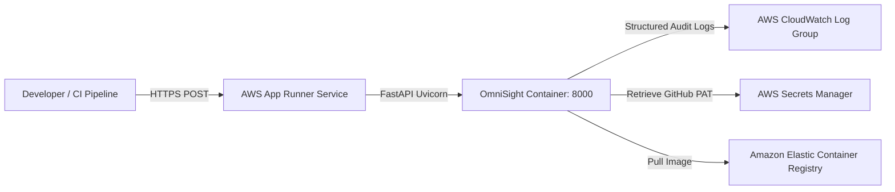

# OmniSight Cloud Infrastructure as Code (Terraform)

This directory contains Terraform HCL configurations for provisioning the containerized **OmniSight FastAPI CI/CD Gateway** on AWS App Runner / Amazon ECS.

---

## 🏛️ Topology



---

## 🔒 Zero Hardcoded Secrets Principles

1. **No Credentials in Version Control**: `.gitignore` strictly rejects `*.tfvars`, `*.tfstate`, and `.terraform/`.
2. **Secrets Delegation**: Sensitive values (such as the fine-grained `GITHUB_TOKEN` and `WEBHOOK_SECRET`) are referenced by ARN from AWS Secrets Manager.
3. **Least-Privilege IAM**: The App Runner instance role has permissions scoped exclusively to the OmniSight CloudWatch log group and designated secret prefixes.

---

## 🚀 Deployment Instructions

### 1. Prerequisites
- [Terraform CLI](https://developer.hashicorp.com/terraform/install) >= 1.5.0
- [AWS CLI](https://aws.amazon.com/cli/) configured with deployment credentials (`aws configure`)
- Container image pushed to Amazon ECR

### 2. Configure Variables
Copy the template and supply your environment values:
```bash
cp terraform.tfvars.example terraform.tfvars
```

### 3. Initialize & Plan
```bash
terraform init
terraform plan -out=tfplan
```

### 4. Apply Infrastructure
```bash
terraform apply tfplan
```

### 5. Verify Health Endpoint
```bash
curl -f $(terraform output -raw health_check_url)
```

---

## 🧹 Tear Down
To destroy provisioned cloud resources:
```bash
terraform destroy -auto-approve
```
