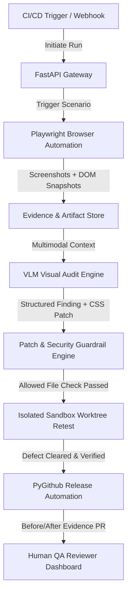

# OmniSight System Architecture

OmniSight is an AI-assisted visual quality assurance (QA) and self-healing platform for web applications. It automates browser journeys, collects responsive multi-viewport visual and DOM evidence, reasons over visual defects using multimodal Vision-Language Models (VLMs), and generates constrained, verified code repairs submitted via automated Pull Requests.

---

## 1. High-Level Component Topology

---

## 2. Team Workload Division & Ownership

| Component | Owner | Responsibilities | Primary Technologies |
|---|---|---|---|
| **Automation & Agent Loop** | **Team Lead (Kailash)** | Playwright browser runner, multi-viewport capture, DOM context extraction, VLM adapter, agent orchestration, and system integration. | Python, Playwright, VLM APIs |
| **Backend & PR Service** | **Member 1 (Sri Khyathi)** | FastAPI build gateway, run state management, patch security validation, and PyGithub automated PR workflows. | FastAPI, Pydantic, PyGithub |
| **Target App & QA Dashboard** | **Member 2 (Jahnavi Alluri)** | Mock e-commerce storefront (`app-under-test`) with deterministic visual bugs, and React QA management dashboard. | React, Vite, CSS |

---

## 3. The Closed Remediation Loop

1. **Trigger**: A webhook or manual API call triggers a test run targeting an active deployment or local server.
2. **Browser Execution**: Playwright drives the browser through the checkout flow (Home &rarr; Cart &rarr; Checkout) at 4 defined viewport sizes.
3. **Evidence Collection**: Full-page screenshots, focused element geometry, DOM snapshots, and console error logs are collected per viewport into `artifacts/runs/<run-id>/`.
4. **Visual Audit**: A Vision-Language Model (GPT-4o / LLaVA / Claude Vision) processes visual evidence and DOM structure, returning structured JSON findings identifying defect categories, coordinates, and proposed fixes.
5. **Patch Validation**: The patch engine validates that the proposed fix touches only allowlisted style files (`app-under-test/src/styles/`), rejecting absolute paths, path traversals, or arbitrary scripts.
6. **Isolated Retest**: The patch is applied in an isolated workspace/branch, and Playwright reruns the identical scenario to capture `after.png`.
7. **Evaluation**: Automated visual and DOM verification compares before vs. after. Retries are strictly bounded (max 1 retry) to prevent runaway execution.
8. **PR Creation**: If verified fixed, PyGithub creates a fix branch and opens a Pull Request with complete before/after evidence attached.
9. **Human Oversight**: A human reviewer reviews the visual proof on GitHub or the QA Dashboard before merging to production.

---

## 4. Engineering Safeguards & Security Model

* **Zero-Trust File Access**: Generated patches can only modify files in the designated allowlist (`app-under-test/src/styles/`). All JavaScript, shell, and configuration modifications are rejected.
* **Deterministic Baseline**: Seeded defects in `app-under-test/src/styles/defects.css` provide repeatable visual anomalies for audit benchmarking.
* **Strict Retest Requirement**: No Pull Request is ever opened without browser-verified proof that the defect was cleared.
