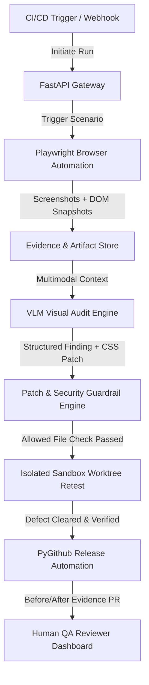
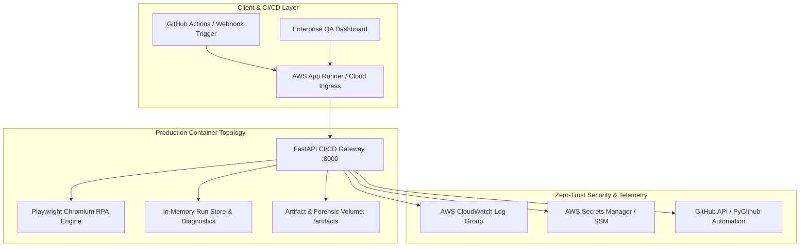

# OmniSight System Architecture

OmniSight is an AI-assisted visual quality assurance (QA) and self-healing platform for web applications. It automates browser journeys, collects responsive multi-viewport visual and DOM evidence, reasons over visual defects using multimodal Vision-Language Models (VLMs), and generates constrained, verified code repairs submitted via automated Pull Requests.

---

## 1. High-Level Component Topology

---

## 2. Team Workload Division & Ownership

| Component | Owner | Responsibilities | Primary Technologies |
|---|---|---|---|
| **Automation & Agent Loop** | **Team Lead (Kailash)** | Playwright browser runner, multi-viewport capture, DOM context extraction, VLM adapter, agent orchestration, and system integration. | Python, Playwright, VLM APIs |
| **Backend & PR Service** | **Member 1 (Sri Khyathi)** | FastAPI build gateway, run state management, patch security validation, and PyGithub automated PR workflows. | FastAPI, Pydantic, PyGithub |
| **Target App & QA Dashboard** | **Member 2 (Jahnavi Alluri)** | Mock e-commerce storefront (`app-under-test`) with deterministic visual bugs, and React QA management dashboard. | React, Vite, CSS |

---

## 3. The Closed Remediation Loop

1. **Trigger**: A webhook or manual API call triggers a test run targeting an active deployment or local server.
2. **Browser Execution**: Playwright drives the browser through the checkout flow (Home &rarr; Cart &rarr; Checkout) at 4 defined viewport sizes.
3. **Evidence Collection**: Full-page screenshots, focused element geometry, DOM snapshots, and console error logs are collected per viewport into `artifacts/runs/<run-id>/`.
4. **Visual Audit**: A Vision-Language Model (GPT-4o / LLaVA / Claude Vision) processes visual evidence and DOM structure, returning structured JSON findings identifying defect categories, coordinates, and proposed fixes.
5. **Patch Validation**: The patch engine validates that the proposed fix touches only allowlisted style files (`app-under-test/src/styles/`), rejecting absolute paths, path traversals, or arbitrary scripts.
6. **Isolated Retest**: The patch is applied in an isolated workspace/branch, and Playwright reruns the identical scenario to capture `after.png`.
7. **Evaluation**: Automated visual and DOM verification compares before vs. after. Retries are strictly bounded (max 1 retry) to prevent runaway execution.
8. **PR Creation**: If verified fixed, PyGithub creates a fix branch and opens a Pull Request with complete before/after evidence attached.
9. **Human Oversight**: A human reviewer reviews the visual proof on GitHub or the QA Dashboard before merging to production.

---

## 4. Engineering Safeguards & Security Model

* **Zero-Trust File Access**: Generated patches can only modify files in the designated allowlist (`app-under-test/src/styles/`). All JavaScript, shell, and configuration modifications are rejected.
* **Deterministic Baseline**: Seeded defects in `app-under-test/src/styles/defects.css` provide repeatable visual anomalies for audit benchmarking.
* **Strict Retest Requirement**: No Pull Request is ever opened without browser-verified proof that the defect was cleared.

---

## 5. Week 4 Production Hardening & Cloud Topology

OmniSight Week 4 introduces containerized deployment and Cloud Infrastructure as Code (IaC) via Terraform:

### Containerization Strategy:
- **FastAPI & Playwright Image** (`Dockerfile`): Multi-stage Debian-slim image packaging Python 3.11, Playwright Chromium headless engine, and Uvicorn ASGI server with `/health` health checks.
- **QA Review Dashboard** (`dashboard/Dockerfile`): Multi-stage Alpine container compiling React 18 / Vite SPA assets and serving through production Nginx with reverse proxy for `/api/`.
- **Target Application** (`app-under-test/Dockerfile`): Production container serving the mock everyday e-commerce storefront.
- **Docker Compose** (`docker-compose.yml`): Full-stack orchestration establishing network isolation (`omnisight-net`), volume mounts for artifacts, and health check dependencies.

### Cloud Infrastructure as Code (Terraform):
- Located in `backend/terraform/`.
- Provisions AWS App Runner Service with auto-scaling (1-5 instances), CloudWatch log groups, and IAM least-privilege execution roles.
- Zero hardcoded credentials: sensitive PATs and webhook keys are managed through AWS Secrets Manager and `.tfvars` excluded from source control.

---

## 6. Production Health Probes & Lifecycle Protocol

OmniSight exposes multi-tier health and diagnostic endpoints for cloud container orchestrators:

- **Liveness Probe (`GET /health/liveness`)**: Evaluates process responsiveness and ASGI event loop vitality.
- **Readiness Probe (`GET /health/readiness`)**: Validates database records, disk write permissions on `/artifacts/runs`, and concurrency saturation. Returns HTTP 503 during graceful shutdown draining.
- **Concurrency Guard (`GET /api/system/concurrency`)**: Monitors worker pool capacity (5 concurrent runs default) to prevent CPU and memory starvation on browser automation hosts.
- **Graceful Shutdown**: Traps SIGTERM / SIGINT, sets draining state, terminates child browser processes, and flushes forensic logs before container eviction.

---

## 7. Spatial Optimization & VLM Token Economics

To optimize inference latency and cost at scale, OmniSight implements localized anomaly cropping:
1. Anomaly bounding box coordinates are extracted from DOM geometry.
2. A contextual margin (24px or 15%) is applied with boundary clamping to the viewport dimensions.
3. Cropping reduces multimodal image payload area by >85%, lowering VLM vision token consumption from ~1,200 tokens to under 250 tokens per evaluation.
