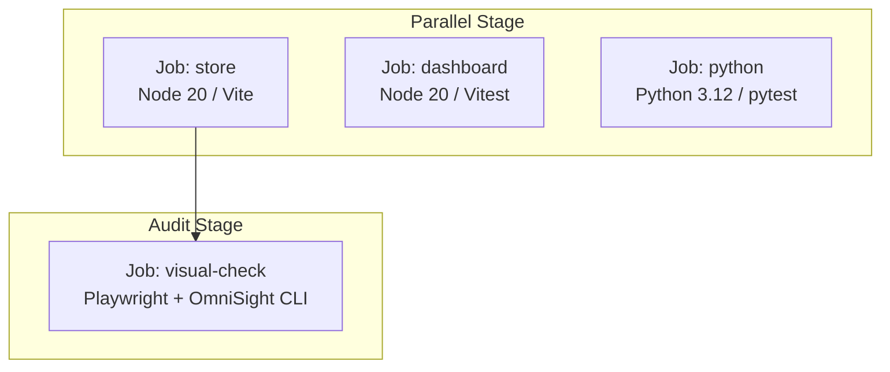

# OmniSight CI/CD Pipeline Architecture & Test Guidelines

This document details the Continuous Integration & Deployment (CI/CD) workflow configuration, multi-platform test discovery rules, and diagnostic endpoints.

---

## 1. CI Workflow Overview

The GitHub Actions CI pipeline (`.github/workflows/ci.yml`) executes on every Pull Request and push to `main`. It consists of four parallel and sequential jobs:



### Job Matrix

| Job Name | Runner | Environment | Responsibilities |
|---|---|---|---|
| `store` | `ubuntu-latest` | Node.js 20 | Builds `app-under-test` mock store, runs vitest unit tests. |
| `dashboard` | `ubuntu-latest` | Node.js 20 | Builds reviewer dashboard, runs 17 frontend unit & logic tests. |
| `python` | `ubuntu-latest` | Python 3.12 | Installs Playwright Chromium dependencies, runs 187 backend & automation pytest tests. |
| `visual-check` | `ubuntu-latest` | Python 3.12 + Node 20 | Starts local store daemon, executes `python -m automation.cli`, captures findings, renders GitHub Step Summary, uploads forensic artifacts. |

---

## 2. Multi-Platform Test Discovery (`pytest.ini`)

To guarantee identical test discovery across Windows development environments and Ubuntu Linux CI runners, the root [`pytest.ini`](../pytest.ini) configures the execution pythonpath:

```ini
[pytest]
pythonpath = . backend
testpaths = automation/tests backend/tests
addopts = -ra
filterwarnings =
    ignore::DeprecationWarning
```

### Running Tests Locally

```bash
# Run complete Python test suite (all 187 tests)
python -m pytest -q

# Run specific test suites
python -m pytest automation/tests/
python -m pytest backend/tests/

# Run Dashboard tests (17 tests)
npm test --prefix dashboard

# Run Store tests
npm test --prefix app-under-test
```

---

## 3. Visual QA Exit Code Protocol

When `python -m automation.cli` executes:
- Exit code `0`: Audit completed successfully (defects detected, reviewed, or fixed).
- Exit code `1`: Fatal unhandled execution exception or unreachable target crash.

Intentional defect detection on the store under test outputs findings to `audit.json` with status `needs_review` or `audited`, which exits `0` and renders a defect table in the GitHub Actions summary.

---

## 4. Diagnostic & Export Endpoints

The FastAPI backend provides runtime diagnostics and report export endpoints:

- `GET /health`: Checks service readiness, uptime, active run count, and database size.
- `GET /api/diagnostics`: Returns platform OS, Python version, allowed hosts, and active runs.
- `GET /runs/{run_id}/export/markdown`: Downloads an executive audit summary formatted in GitHub Flavored Markdown.
- `GET /runs/{run_id}/export/json`: Downloads full structured forensic run telemetry.
