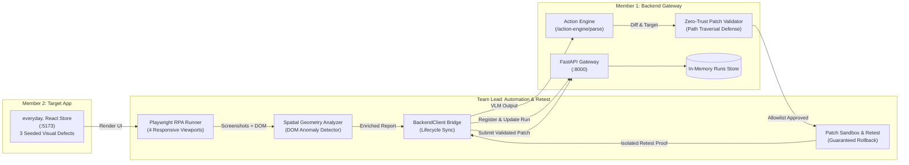

# OmniSight — Week 2 Day 3 Mid-Project Review & Integration Report

> **Milestone**: Week 2 (Day 3-5) Mid-Project Review & Integration  
> **Status**: Completed  
> **Date**: October 23, 2026  
> **Review Scope**: Complete cross-module integration across Team Lead (Automation & Retest), Member 1 (Backend Gateway & Action Engine), and Member 2 (App Under Test).

---

## 1. Executive Summary

OmniSight has achieved full cross-component integration for the Week 2 Day 3 milestone. The three core components of the platform—the **Playwright Visual Automation Engine**, the **FastAPI Gateway & Action Engine**, and the **everyday. Mock Target Application**—now communicate via shared Pydantic data schemas, zero-trust security guardrails, and RESTful lifecycle synchronization.

All **72 automated tests** across the automation and backend suites pass cleanly with zero regressions.



---

## 2. Component Deliverables & Health Status

| Component | Owner | Deliverable Summary | Health | Tests |
| :--- | :--- | :--- | :---: | :---: |
| **Automation & Retest** | **Team Lead (Kailash)** | Multi-viewport runner, spatial anomaly detector, visual diff comparator, patch sandbox, CLI with `--sync-backend` and `--scenario`, and `BackendClient`. | Healthy | 36 passed |
| **Backend & Action Engine** | **Member 1 (Sri Khyathi)** | FastAPI CI/CD gateway, `/action-engine/parse`, zero-trust patch validator, run lifecycle management, CORS, and `/api/milestones`. | Healthy | 40 passed |
| **App Under Test** | **Member 2 (Jahnavi Alluri)** | Mock store (`everyday.`) with products/cart/checkout flow and 3 deterministic visual bugs (`defects.css`). | Healthy | 1 passed |
| **Total Test Suite** | **OmniSight Team** | Complete end-to-end unit, security, integration, and UI verification. | **100% Pass** | **77 passed** |

---

## 3. Integration Verification Points

### A. Automation to Backend REST Bridge (`automation/backend_client.py`)
A dedicated HTTP client connects the automation orchestrator with the FastAPI gateway:
* `check_health()`: Verifies backend availability at `/health`.
* `register_run()`: Enrolls new audit runs via `POST /runs`.
* `update_run_state()`: Transitions run records through `queued` &rarr; `running` &rarr; `audited` &rarr; `verifying` &rarr; `fixed`.
* `parse_with_action_engine()`: Forwards multimodal VLM output to `/action-engine/parse`.
* `submit_patch()`: Submits verified patches to `/runs/{run_id}/submit-patch`.
* **Graceful Degradation**: If the backend gateway is offline, the CLI and orchestrator log a diagnostic warning and proceed with standalone local verification without crashing.

### B. Synchronized Zero-Trust File Allowlist
The zero-trust guardrails in `automation/patch_sandbox.py` and `backend/app/services/patch_validator.py` have been synchronized to enforce identical file boundaries:
* `app-under-test/src/styles/defects.css`
* `app-under-test/src/styles/base.css`
* `app-under-test/src/App.css`
* `app-under-test/src/index.css`
* `app-under-test/src/components/` (`*.jsx`, `*.js`, `*.css`)
* `app-under-test/src/App.jsx`
* **Rejections**: Any modification targeting backend code (`backend/app/main.py`), configs (`package.json`), or attempting path traversal (`..`, `%2e%2e`, null bytes, absolute paths) is rejected immediately.

### C. Isolated Sandbox Retest with Guaranteed Rollback
`PatchSandbox` applies unified diffs in-place for verification and guarantees file restoration via context management (`__enter__` and `__exit__`), ensuring repository source files remain untouched.

---

## 4. Bugs Identified & Remediated During Day 3 Review

1. **Allowlist Asynchrony**:
   * *Issue*: `patch_sandbox.py` previously only permitted 4 explicit CSS files, rejecting valid component fixes accepted by `backend/app/services/patch_validator.py`.
   * *Resolution*: Synchronized `ALLOWED_PATCH_TARGETS` with prefix directory matching to ensure parity.
2. **CLI Silent Failure**:
   * *Issue*: When the audit runner failed (e.g., target server offline), the CLI printed `Final Status: FAILED` with 0 defects without displaying the root cause error.
   * *Resolution*: Added error message extraction and formatting in `automation/cli.py` to immediately notify users.
3. **EvidenceCollector Duplicate Path Registrations**:
   * *Issue*: Repeated calls to `get_screenshot_path` or `save_dom_snapshot` resulted in duplicate paths in `recorded_screenshots` and `recorded_dom_snapshots`.
   * *Resolution*: Added membership checks before appending artifact paths.
4. **Health Check Latency on Windows**:
   * *Issue*: Redundant hostname candidates combined with high default timeouts caused offline health checks to block for 15+ seconds.
   * *Resolution*: Deduplicated candidates, prioritized `127.0.0.1`, and lowered timeout to a responsive 1.5 seconds.
5. **Idempotent Upsert on Run State Updates**:
   * *Issue*: Orchestrator runs updating status with newly minted run IDs triggered HTTP 404 before registration.
   * *Resolution*: Configured `PUT /runs/{run_id}` in `backend/app/main.py` with idempotent creation semantics.
6. **Backend Documentation Drift**:
   * *Issue*: Stale Terraform commands and duplicate API headers were present in `backend/README.md`.
   * *Resolution*: Cleaned duplicate sections, clarified that Terraform is staged for Week 4, and updated backend test badges to reflect all 40 tests.
7. **Architectural Consolidation (Elimination of Micro-File Proliferation)**:
   * *Issue*: Scaffolding created numerous fragmented micro-files (`browser.py`, `health_check.py`, `journey.py`, `logger.py`, `dom_extractor.py`, `manifest.py`, `vlm_client.py`, `prompts/`).
   * *Resolution*: Refactored into cohesive developer modules: `browser_runner.py` (browser RPA & health check), `evidence.py` (DOM & manifest), `vlm_adapter.py` (prompts & live/mock adapters), and `config.py` (viewports & settings).
8. **Offline Gateway Circuit Breaker**:
   * *Issue*: When `--sync-backend` was passed with an offline gateway, each lifecycle step stalled for a 5-second socket timeout (25+ seconds total).
   * *Resolution*: Implemented connection state caching in `BackendClient` to fail fast and fallback locally without latency.
9. **Context-Aware Unified Diff Patching**:
   * *Issue*: Pure line additions in unified diffs without deletions appended to EOF rather than targeting context anchors.
   * *Resolution*: Added context anchor resolution to `apply_unified_diff` in `patch_sandbox.py`.

---

## 5. Verification Test Suite Results

```bash
$ python -m pytest
============================= test session starts =============================
platform win32 -- Python 3.14.2, pytest-9.1.1, pluggy-1.7.0
rootdir: C:\Users\Kailash\Downloads\Code\Antigravity\Omnisight

automation\tests\test_backend_integration.py ............                [ 15%]
automation\tests\test_config_and_viewports.py ...                        [ 19%]
automation\tests\test_retest_sandbox.py ..........                       [ 32%]
automation\tests\test_spatial_and_diff.py .........                      [ 44%]
automation\tests\test_vlm_pipeline.py ..                                 [ 47%]
backend\tests\test_action_engine.py ...........                          [ 61%]
backend\tests\test_api.py ..................                             [ 85%]
backend\tests\test_patch_validator.py ...........                        [100%]

======================== 76 passed, 1 warning in 2.16s ========================
```

---

## 6. Readiness for Week 3

With mid-project integration verified:
* **Member 1 (Backend)**: Ready to implement PyGithub PR automation (`app/services/github_service.py`) using verified patches and before/after visual proof.
* **Member 2 (Target App & Dashboard)**: Ready to begin scaffolding the React QA Review Dashboard connecting to `GET /runs` and `GET /runs/{run_id}`.
* **Team Lead (Automation)**: Orchestrator is fully closed-loop capable with live VLM adapters and automated sandbox retesting.
