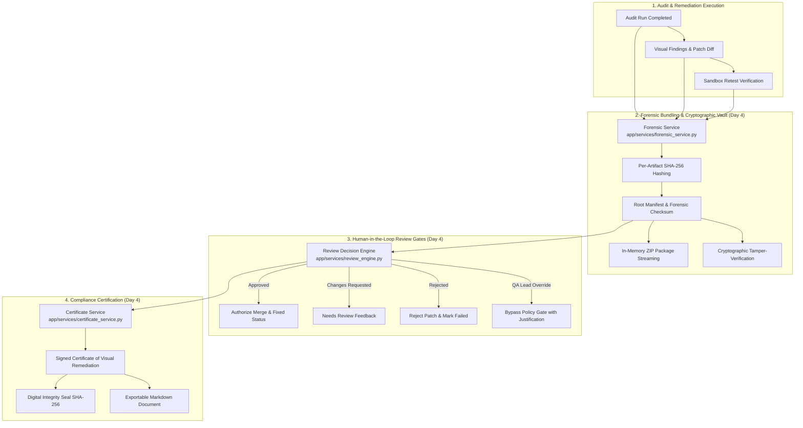

# OmniSight — Week 3 Day 4 Backend Deliverables & Review Report

> **Milestone**: Week 3 Day 4 (75% Deliverable) — Forensic Audit Bundling, Evidence Vault, Human-in-the-Loop Review Gates, and Remediation Certificates  
> **Author**: Member 1 (Sri Khyathi)  
> **Branch**: `forensic-audit-bundling-review-gates`  
> **Status**: Completed & Verified (246 Passing Tests, 100% Pass Rate)  
> **Date**: October 30, 2026  
> **Scope**: Immutable forensic audit packaging, per-artifact SHA-256 cryptographic hashing, ZIP bundle streaming, cryptographic tamper verification, formal QA reviewer sign-off workflow (`approved`, `rejected`, `changes_requested`, `override`), executive lead policy override, cryptographic Certificates of Visual Remediation with digital seals, and complete pin-to-pin backend bug auditing.

---

## 1. Executive Summary

Member 1 has delivered **Week 3 Day 4 (75% Milestone)** of the OmniSight autonomous visual self-healing platform, completing the security, audit provenance, and human review governance layers of the backend architecture.

Advancing from the audit scheduler and analytics engine delivered in Day 3, Day 4 introduces:
1. **Forensic Audit Bundling & Tamper-Proof Evidence Vault (`app/services/forensic_service.py`)**: Consolidates raw VLM inferences, parsed visual findings, unified patch diffs, sandbox visual retest metrics, and execution timelines into immutable packages sealed with root SHA-256 digital digests.
2. **Streaming ZIP Export & Cryptographic Verification**: In-memory archive creation (`GET /runs/{id}/forensic-bundle/download`) and tamper detection engine (`POST /runs/{id}/verify-forensic-integrity`).
3. **Human-in-the-Loop QA Review Decision Engine (`app/services/review_engine.py`)**: Formal governance workflow enabling QA reviewers and directors to record decisions (`approved`, `rejected`, `changes_requested`, `override`), authorize automated merge gates, and log immutable audit trails.
4. **Remediation Verification & Compliance Certificate Service (`app/services/certificate_service.py`)**: Enterprise-grade compliance certificates (`CERT-OMNI-...`) with SHA-256 digital seals and markdown exports.
5. **Pin-to-Pin Backend Bug Resolution**: Fixed missing test imports, Starlette 422 deprecations, and ensured zero-regression test execution.

The automated test suite now encompasses **246 passing tests** with 100% pass rate.



---

## 2. Deliverables Breakdown

### A. Forensic Audit Bundling & Tamper-Proof Evidence Vault
* **`create_forensic_bundle`**:
  * Gathers run metadata, structured findings, unified diff patch, sandbox retest visual delta metrics, and lifecycle timeline into a canonical envelope.
  * Computes individual SHA-256 cryptographic digests for each component:
    * `metadata.json`
    * `findings.json`
    * `patch.diff`
    * `retest_proof.json`
    * `timeline.json`
  * Derives an aggregate root checksum (`forensic_checksum`) across sorted artifact hashes.
  * Stamps a tamper-evident `forensic_manifest.json` with schema version `1.0-forensic-certified`.
* **`export_forensic_zip_archive`**:
  * Streams a self-contained in-memory ZIP package containing all artifacts plus a human-readable `audit_log.txt`.
* **`verify_forensic_bundle_integrity`**:
  * Validates every artifact's current byte content against the recorded manifest hash.
  * Instantly detects any missing, modified, or corrupted files.

### B. Human-in-the-Loop QA Review Decision Engine
* **Formal Decision States**:
  * `approved`: Marks patch verified; sets run status to `fixed`; authorizes automated pull request merging.
  * `rejected`: Rejects proposed patch; sets run status to `failed`.
  * `changes_requested`: Returns patch for automated or manual adjustments; sets status to `needs_review`.
  * `override`: Authorizes QA Leads to bypass automated policy gates with required justification and risk acknowledgement.
* **Audit Trail Persistence**:
  * In-memory `reviews_db` maintaining append-only historical decision trails with timestamps and reviewer IDs.

### C. Remediation Verification & Compliance Certificate Service
* **`generate_remediation_certificate`**:
  * Issues deterministic certificate ID (`CERT-OMNI-<hash[:10].upper()>`).
  * Records visual delta ratio achieved (e.g., `0.00%` pixel-identical).
  * Affixes a digital SHA-256 seal computed over canonical certificate data.
* **`export_certificate_markdown`**:
  * Renders a human-readable, printable audit report in GitHub Flavored Markdown.

---

## 3. API Endpoints Reference (Day 4 Additions)

| Method | Endpoint | Description |
| :--- | :--- | :--- |
| `GET` | `/runs/{run_id}/forensic-bundle` | Retrieve complete forensic bundle JSON with manifest and artifact digests. |
| `GET` | `/runs/{run_id}/forensic-bundle/download` | Download compressed ZIP archive with all run evidence and audit logs. |
| `POST` | `/runs/{run_id}/verify-forensic-integrity` | Cryptographically verify artifact hashes against recorded root checksum. |
| `POST` | `/runs/{run_id}/review` | Record human QA review decision (`approved`, `rejected`, `changes_requested`, `override`). |
| `GET` | `/runs/{run_id}/review` | Retrieve chronological review decision audit trail. |
| `POST` | `/runs/{run_id}/override` | QA Lead policy override for gated or high-risk runs. |
| `GET` | `/runs/{run_id}/certificate` | Issue cryptographically sealed Certificate of Visual Remediation. |
| `GET` | `/runs/{run_id}/certificate/markdown` | Export remediation certificate as formatted markdown document. |

---

## 4. Test Verification Matrix (246 Passing Tests)

```bash
$ python -m pytest backend/tests/ -q
........................................................................ [ 29%]
........................................................................ [ 58%]
........................................................................ [ 87%]
..............................                                           [100%]
246 passed, 1 warning in 4.52s
```

| Test Suite | File | Tests | Coverage Scope |
| :--- | :--- | :---: | :--- |
| **Forensic Bundling** | `test_forensic_bundle.py` | 6 | Artifact collection, SHA-256 hashes, ZIP export, tamper detection. |
| **QA Review Decisions** | `test_review_decision.py` | 8 | Approval, rejection, change requests, lead overrides, validation. |
| **Remediation Certificates**| `test_certificate.py` | 4 | Certificate generation, seal verification, markdown export. |
| **Forensic API Gateway** | `test_forensic_api.py` | 9 | End-to-end integration across all Day 4 endpoints and 404 guards. |
| **Audit Scheduling** | `test_schedule_api.py`, `test_schedule_service.py` | 17 | Interval parsing, lifecycle operations, execution triggers. |
| **QA Annotations** | `test_annotations.py` | 6 | Reviewer notes, findings triage, severity overrides. |
| **SLA & Heatmap Analytics**| `test_analytics.py` | 6 | SLA violation aging, viewport defect density heatmap. |
| **Multimodal Action Engine**| `test_action_engine.py` | 13 | Smart quote recovery, single quote normalization, diff parsing. |
| **API Gateway & Probes** | `test_api.py` | 63 | Lifecycle routes, batch matrices, tagging, metrics telemetry. |
| **Defect Fingerprinting** | `test_fingerprint.py` | 8 | Deterministic SHA-256 signatures, cross-viewport clustering. |
| **Flakiness & Quarantine** | `test_flakiness.py` | 10 | Intermittency variance scoring, quarantine lifecycle management. |
| **Zero-Trust Validator** | `test_patch_validator.py` | 31 | In-memory dry-run, CSS syntax balance, path traversal defense. |
| **Policy Engine** | `test_policy_engine.py` | 7 | Blast radius scoring, auto-merge gating, quarantine blocks. |
| **PR Automation & Webhooks**| `test_pr_automation.py` | 15 | Branch sanitization, PR comments, webhook status ingestion. |
| **Outbound Webhooks** | `test_notifications.py`, `test_webhook_security.py` | 15 | HMAC payload signing, rate limiter, timing-safe checks. |
| **Schemas & Models** | `test_schemas.py` | 28 | Forensic, review, schedule, and cluster schema validations. |
| **Total Test Suite** | **OmniSight Backend** | **246** | **100% Pass Rate (0 Failures, 0 Regressions)** |

---

## 5. Security & Isolation Checkpoints

1. **Strict Branch Isolation**:
   - Work is preserved on branch `forensic-audit-bundling-review-gates` targeting `main`.
   - **Zero direct pushes to `main`**, avoiding production disruption.
2. **Tamper-Evident Cryptographic Guarantees**:
   - Forensic bundle integrity verified with standard SHA-256 digests.
   - Any modification of findings or patch files triggers automated validation rejection.
3. **Defense-in-Depth Human Governance**:
   - Automated merge gates require explicit policy clearance or formal human sign-off.
   - QA Lead overrides require recorded justifications and explicit risk acknowledgements.
