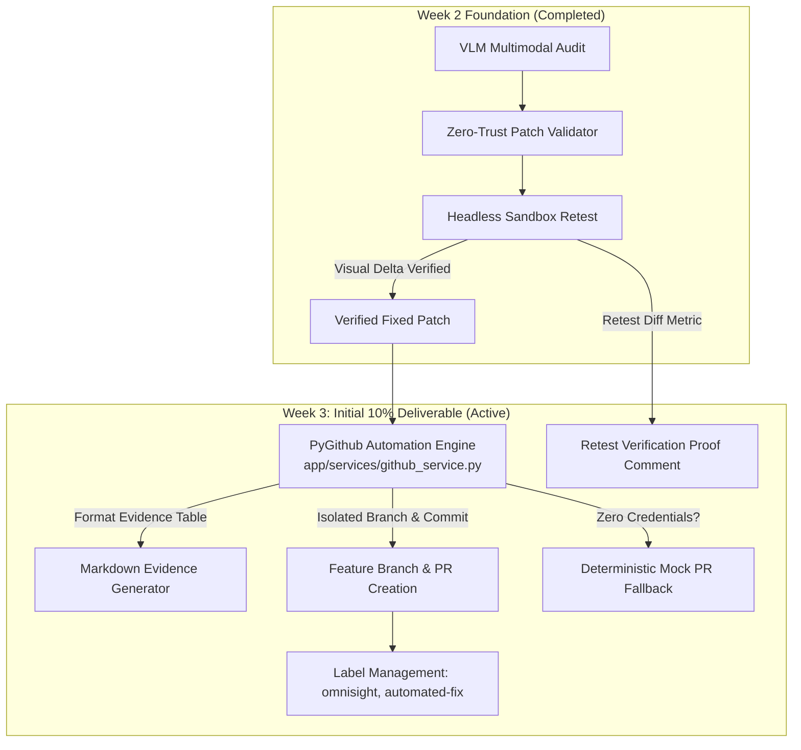

# OmniSight — Week 3 Kickoff & 10% Milestone Report

> **Milestone**: Week 3 Day 1 Kickoff (10% Deliverable)  
> **Status**: Completed (10% Progress Committed to `main`)  
> **Date**: October 28, 2026  
> **Owner**: Member 1 (Backend & PR Automation) & Team Lead (Automation)  

---

## 1. Executive Summary

With the Week 2 Mid-Project Review and Dashboard integration verified and merged into `main`, Week 3 work has commenced. Week 3 focuses on **Bounded Self-Healing & the Automated Pull Request Engine**, closing the loop from browser RPA inspection and VLM audit to verified patch deployment on GitHub.

This initial 10% milestone delivers the **PyGithub Pull Request Automation Engine**, mock fallback resilience for offline development, evidence-backed Markdown PR template generation, custom label assignment, and verification retest comment integration.

The repository test suite now stands at **93 automated passing tests** with 100% pass rate.



---

## 2. Deliverables Breakdown (Week 3 — 10% Progress)

### 1. PyGithub Automation Service (`backend/app/services/github_service.py`)
* **`create_pull_request_for_fix()`**:
  - Connects to GitHub API using centralized credentials (`GITHUB_TOKEN`, `REPO_NAME`).
  - Creates isolated feature branch (`omnisight-fix-{run_id}`) with collision resilience.
  - Commits validated style patch to the feature branch.
  - Opens evidence-backed Pull Request against `main`.
  - Automatically attaches categorization labels (`omnisight`, `automated-fix`).
* **Mock Fallback Resilience (`MOCK_GITHUB`)**:
  - When running offline or when `GITHUB_TOKEN` is unset/dummy, gracefully falls back to deterministic mock PR URLs (`https://github.com/Kailash-18/OmniSight/pull/{id}`).
  - Enables local testing without hitting GitHub API rate limits.
* **`generate_pr_markdown_description()`**:
  - Formats standard GitHub Markdown description with defect summary, target file, affected viewport, verification status, unified git diff, and side-by-side visual evidence table.
* **`add_pr_comment_with_retest_evidence()` & `update_pull_request_verification_proof()`**:
  - Posts structured verification tables directly to the PR with visual diff scores, viewport tags, and pass/fail badges.

### 2. Backend Gateway Integration (`backend/app/main.py`)
* **`POST /runs/{run_id}/create-pr`**:
  - Direct endpoint to open or re-open a Pull Request for an audited/verified run.
* **`POST /runs/{run_id}/submit-patch`**:
  - Added optional `auto_create_pr` flag to automatically open a PR upon successful patch validation.
* **`POST /runs/{run_id}/update-pr-verification`**:
  - Attaches verified sandbox retest evidence to the open PR.
* **`GET /api/milestones`**:
  - Updated tracking status to `week_3_pr_automation: in_progress` (10% completed).

### 3. Client & Orchestrator Coordination (`automation/backend_client.py`)
* Added `create_pull_request()` helper to `BackendClient` to facilitate automated closed-loop PR triggering from the automation runner.

---

## 3. Test Verification Matrix (93 Passing Tests)

```bash
$ python -m pytest
============================= test session starts =============================
platform win32 -- Python 3.14.2, pytest-9.1.1, pluggy-1.7.0
rootdir: C:\Users\Kailash\Downloads\Code\Antigravity\Omnisight

automation\tests\test_backend_integration.py ...............             [ 16%]
automation\tests\test_config_and_viewports.py ...                        [ 19%]
automation\tests\test_retest_sandbox.py ..........                       [ 30%]
automation\tests\test_spatial_and_diff.py .........                      [ 39%]
automation\tests\test_vlm_pipeline.py ..                                 [ 41%]
backend\tests\test_action_engine.py .............                        [ 55%]
backend\tests\test_api.py .....................                          [ 78%]
backend\tests\test_patch_validator.py ...........                        [ 90%]
backend\tests\test_pr_automation.py .........                            [100%]

======================== 93 passed, 1 warning in 2.59s ========================
```

| Suite | Tests | Status | Scope |
| :--- | :---: | :---: | :--- |
| `test_pr_automation.py` | 9 | Passed | Mock PR fallback, markdown generation, custom labels, retest proof comments, live mock. |
| `test_api.py` | 21 | Passed | Run lifecycle, security validation, auto-create PR flag, create-pr endpoint, milestones. |
| `test_backend_integration.py` | 15 | Passed | Cross-module client coordination, sync loops, create PR via client bridge. |
| `test_action_engine.py` | 13 | Passed | Multimodal prose parsing, quote normalization, diff extraction. |
| `test_patch_validator.py` | 11 | Passed | Path traversal, allowlist enforcement, script injection defense. |
| `automation/tests/*` | 24 | Passed | Viewports, spatial analyzer, visual diff, sandbox rollback. |
| **Total Test Suite** | **93** | **100% Pass** | **Zero Regressions** |

---

## 4. Next Steps for Week 3

1. **Closed-Loop Triggering (25% Milestone)**: Wire orchestrator to automatically invoke `create_pull_request` upon verified sandbox fix (`status == FIXED`).
2. **GitHub Webhook Ingestion (50% Milestone)**: Ingest `pull_request` and `pull_request_review` webhooks to reflect human review and merge status in the QA Dashboard.
3. **Forensic Audit Bundling (75% Milestone)**: Consolidate run logs, DOM snapshots, and visual diffs into an immutable forensic bundle.
4. **Week 3 Final Review (100% Milestone)**: End-to-end multi-viewport live demo with GitHub PR verification.
