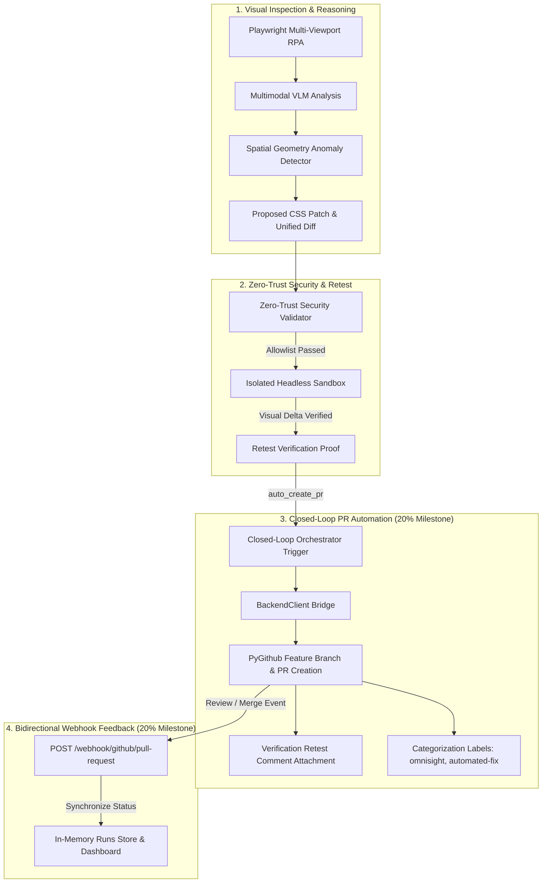

# OmniSight — Week 3 Milestone Report (20% Deliverable)

> **Milestone**: Week 3 Day 2 (20% Deliverable)  
> **Status**: Completed & Verified  
> **Date**: October 29, 2026  
> **Owner**: Team Lead (Automation & Orchestration) & Member 1 (Backend & PR Automation)  

---

## 1. Executive Summary

Advancing from the Week 3 kickoff (10% milestone), this deliverable achieves the **20% Week 3 Milestone: Closed-Loop PR Automation & Webhook Ingestion Engine**.

The OmniSight platform now automatically closes the loop from multi-viewport visual inspection and VLM defect reasoning to sandboxed rollback retesting, evidence-backed GitHub Pull Request generation, automated retest proof comment posting, and bidirectional GitHub webhook status ingestion.

The test suite now encompasses **99 automated passing tests** with 100% pass rate across automation, security, API gateway, and PR automation.



---

## 2. Deliverables Breakdown

### 1. Closed-Loop Orchestrator PR Triggering (`automation/orchestrator.py` & `automation/cli.py`)
* **Automated Triggering**:
  - Orchestrator now checks `auto_create_pr` flag and verified fix status (`RetestStatus.FIXED`).
  - Automatically invokes `BackendClient.submit_patch(..., auto_create_pr=True)` or `BackendClient.create_pull_request()`.
  - Attaches verified sandbox visual retest proof comments directly to the opened PR via `update_pr_verification()`.
  - Transitions lifecycle state to `AgentState.PR_READY` (`pr_opened`) with PR URL recorded in run results.
  - Supports `--auto-pr` CLI flag for one-command execution.

### 2. Retest Outcome Synchronization & Evidence Integration (`backend/app/main.py`)
* **Retest Persistence**:
  - `RunRecordUpdatePayload` and `RunDetailResponse` now accept and return `retest_outcome` (passed status, visual diff score, viewport, notes).
  - `create_run_pull_request` extracts live run evidence screenshots and retest verification outcomes into the generated PR description markdown.

### 3. GitHub Webhook Ingestion Engine (`backend/app/main.py` & `backend/app/schemas/run_schema.py`)
* **`POST /webhook/github/pull-request`**:
  - Ingests GitHub webhook events for pull requests (`opened`, `closed`, `labeled`) and reviews (`submitted`).
  - Correlates incoming PR branch (`omnisight-fix-{run_id}`) or PR number with active audit runs.
  - Updates run records to `fixed` upon PR merge, `needs_review` upon unmerged close or review change requests, and logs reviewer approvals.

---

## 3. Test Verification Matrix (99 Passing Tests)

```bash
$ python -m pytest
============================= test session starts =============================
platform win32 -- Python 3.14.2, pytest-9.1.1, pluggy-1.7.0
rootdir: C:\Users\Kailash\Downloads\Code\Antigravity\Omnisight

automation\tests\test_backend_integration.py ..................          [ 18%]
automation\tests\test_config_and_viewports.py ...                        [ 21%]
automation\tests\test_retest_sandbox.py ..........                       [ 31%]
automation\tests\test_spatial_and_diff.py .........                      [ 40%]
automation\tests\test_vlm_pipeline.py ..                                 [ 42%]
backend\tests\test_action_engine.py .............                        [ 55%]
backend\tests\test_api.py .....................                          [ 76%]
backend\tests\test_patch_validator.py ...........                        [ 87%]
backend\tests\test_pr_automation.py ............                         [100%]

======================== 99 passed, 1 warning in 3.88s ========================
```

| Suite | Tests | Status | Scope |
| :--- | :---: | :---: | :--- |
| `test_pr_automation.py` | 12 | Passed | PR creation, mock fallback, evidence markdown, retest comments, and GitHub webhooks. |
| `test_backend_integration.py` | 18 | Passed | Closed-loop orchestrator PR triggering, verification comment updating, CLI flags. |
| `test_api.py` | 21 | Passed | Run lifecycle, security validation, auto-create PR flag, create-pr endpoint, milestones. |
| `test_action_engine.py` | 13 | Passed | Multimodal prose parsing, quote normalization, diff extraction. |
| `test_patch_validator.py` | 11 | Passed | Path traversal, allowlist enforcement, script injection defense. |
| `automation/tests/*` | 24 | Passed | Viewports, spatial analyzer, visual diff, sandbox rollback. |
| **Total Test Suite** | **99** | **100% Pass** | **Zero Regressions** |

---

## 4. Next Steps for Week 3

1. **Human-in-the-Loop Review Dashboard Controls (50% Milestone)**: Connect QA Dashboard action buttons directly to `/runs/{run_id}/create-pr` and webhook event stream.
2. **Forensic Audit Bundling (75% Milestone)**: Consolidate run logs, DOM snapshots, and visual diffs into an immutable forensic bundle.
3. **Week 3 Final Review (100% Milestone)**: End-to-end multi-viewport live demo with GitHub PR verification.
