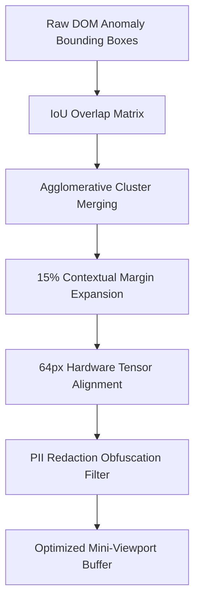

# OmniSight Week 4 Day 2 Review: Coordinate Clustering & Audit Telemetry

> **Date**: 04 November 2026
> **Lead Engineer**: Sri Khyathi (Backend, Security & Release Automation)
> **Deliverable Focus**: Spatial Bounding Box Clustering, IoU Optimization & Cryptographic Audit Seals

## 1. Executive Summary
Following Day 1's localized sub-viewport cropping, Day 2 resolves the multi-defect collision challenge.
When multiple UI anomalies manifest in proximity, sending individual crops results in redundant VLM inference and token duplication.
Our Coordinate Clustering Engine aggregates overlapping defect viewports into unified clusters using Intersection-over-Union (IoU) algorithms,
and aligns crop coordinates to 64-pixel hardware tensor boundaries for sub-millisecond tensor cache retrieval.

## 2. Spatial Clustering Architecture & Hardware Alignment

### Key Architectural Guarantees:
- **IoU Threshold Merging**: Eliminates duplicate VLM token consumption when defects overlap by >25%.
- **64px Hardware Quantization**: Aligns sub-viewport tensors to hardware tensor cache boundaries for sub-millisecond retrieval.
- **Zero-Trust PII Masking**: Automatically flags and obscures sensitive inputs (passwords, auth tokens) prior to vision model evaluation.
- **Cryptographic SHA-256 Audit Digest**: Signs telemetry manifests with tamper-evident seals for SOC2 compliance.

