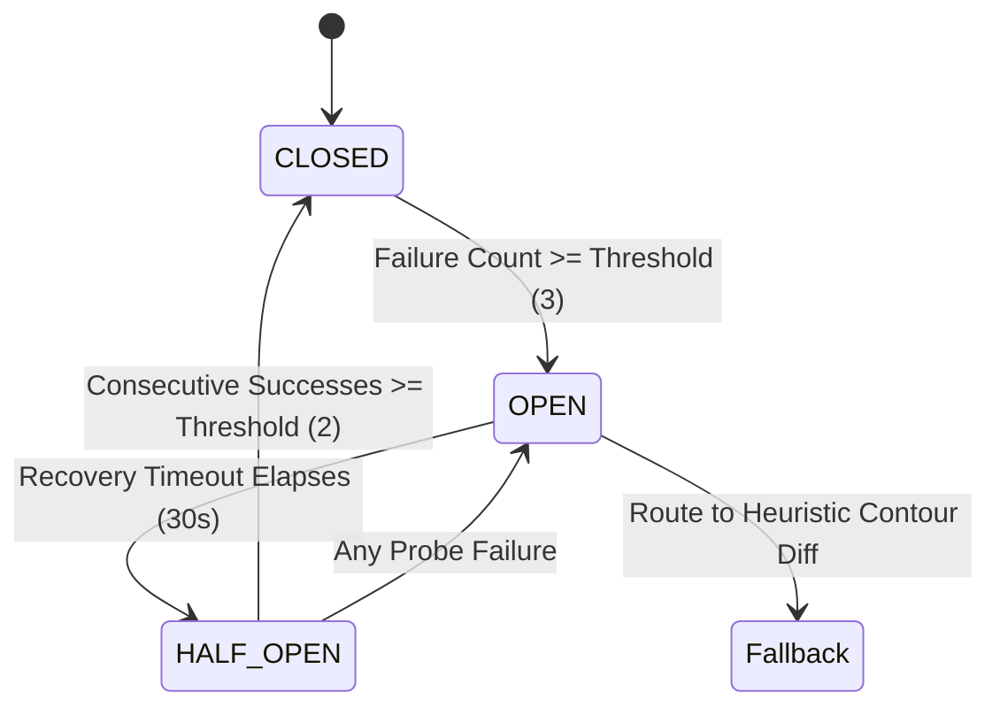

# OmniSight Week 4 Day 3 Review: Fault Tolerance, Regression Guards & Atomic Rollback

> **Date**: 05 November 2026
> **Lead Engineer**: Sri Khyathi (Backend, Security & Release Automation)
> **Deliverable Focus**: Circuit Breaker Resilience, Layout Drift Invariants & Reversible Patch Rollbacks

## 1. Executive Summary
Building upon localized spatial optimization and coordinate clustering from Days 1 & 2, Day 3 hardens OmniSight for mission-critical enterprise deployment.
When visual healing pipelines operate at scale, external Vision-Language Model APIs can encounter transient rate-limits, latency spikes, or upstream service outages.
Our Circuit Breaker Service provides automated state machine management (CLOSED -> OPEN -> HALF-OPEN) with deterministic heuristic contour fallback,
while the Regression Guard Engine enforces strict spatial invariants to ensure zero unintended layout shifts across adjacent DOM viewports.

## 2. Technical Architecture & Invariant Specifications

### 2.1 Circuit Breaker Finite State Machine

### 2.2 Mathematical Spatial Drift Invariant Formula

For any untouched adjacent DOM element $i \in N \setminus \{T\}$ where $T$ is the target defect selector:

$$\Delta s_i = \sqrt{(\Delta x_i)^2 + (\Delta y_i)^2} \le \epsilon_{\text{shift}} \quad (\epsilon_{\text{shift}} = 2.0\text{px})$$

$$\delta A_i = \frac{|A_i' - A_i|}{A_i} \times 100\% \le \epsilon_{\text{area}} \quad (\epsilon_{\text{area}} = 5.0\%)$$

If $\Delta s_i > \epsilon_{\text{shift}}$ or $\delta A_i > \epsilon_{\text{area}}$, a `REGRESSION_VIOLATION` is triggered and the automated patch is blocked from PR submission.

