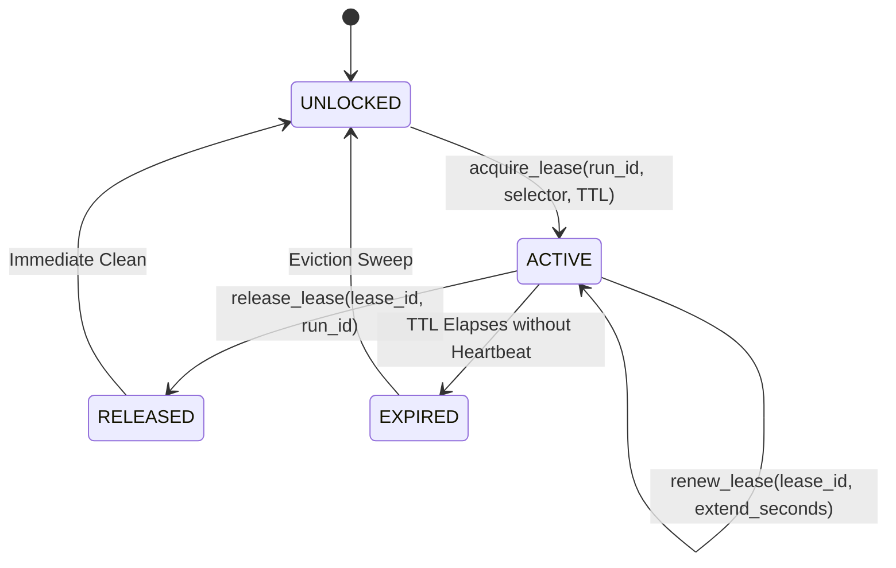
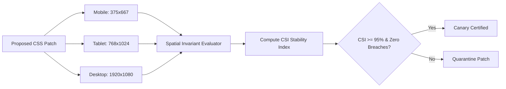

# OmniSight Week 4 Day 4 Review: Concurrency Leases, Cross-Viewport Canary Verification & Live Streaming

> **Date**: 06 November 2026
> **Lead Engineer**: Sri Khyathi (Backend, Security & Release Automation)
> **Deliverable Focus**: Concurrency Locks, Multi-Viewport Canary Stability & Real-Time Event Streaming

## 1. Executive Summary
Advancing from Day 3's Circuit Breaker resilience and atomic rollback architecture, Day 4 resolves
multi-agent concurrency conflicts, cross-viewport responsive regressions, and dashboard latency bottlenecks.
When multiple autonomous visual healing agents operate concurrently across pages, race conditions on DOM selectors
can produce conflicting CSS mutations. Our Distributed Run Lease Manager enforces exclusive, heartbeat-renewed
leases with automatic TTL eviction to guarantee mutation atomicity.
Concurrently, the Cross-Viewport Canary Verification Engine evaluates proposed fixes across mobile (375x667),
tablet (768x1024), and desktop (1920x1080) viewports to compute a unified Canary Stability Index (CSI),
preventing localized desktop fixes from breaking mobile viewports.
Finally, an in-memory Pub/Sub Event Stream Hub delivers live Server-Sent Events (SSE) to enterprise QA dashboards.

## 2. Technical Architecture & Invariant Specifications

### 2.1 Concurrency Lock State Machine & Mutex Architecture

### 2.2 Cross-Viewport Canary Verification Topology

### 2.3 Mathematical Canary Stability Index (CSI) Formula

Let $V = \{v_1, v_2, \dots, v_k\}$ represent the matrix of evaluated responsive viewports (Mobile, Tablet, Desktop).
For each viewport $v \in V$ with $N_v$ evaluated adjacent DOM elements and $D_v$ detected spatial drift violations:

$$S(v) = \max\left(0, 1 - \frac{D_v}{\max(1, N_v)}\right)$$

The aggregated Canary Stability Index (CSI) across the responsive matrix is defined as:

$$\text{CSI} = \left(\frac{1}{|V|} \sum_{v \in V} S(v)\right) \times 100\%$$

If $\text{CSI} < 95.0\%$ or any $D_v > 0$ on critical viewports, the patch fails canary verification and is quarantined.

