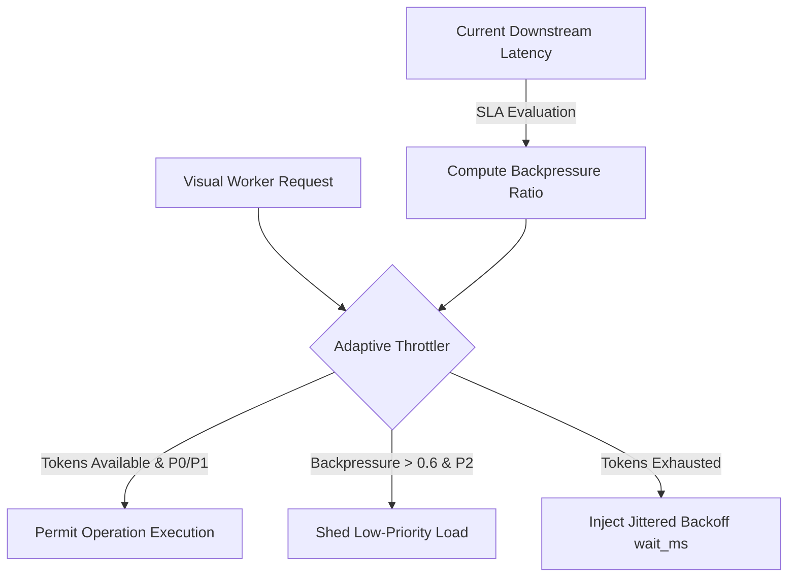

# OmniSight Backend Architecture Review - Week 4 Day 5
**Date:** 07 November 2026  
**Module:** Distributed Self-Healing State Snapshotting, Adaptive Token Throttling & Health Pulse Telemetry  
**Author / Lead:** Sri Khyathi  

## 1. Executive Summary & Objective

Week 4 Day 5 extends the OmniSight autonomous remediation pipeline with three mission-critical backend systems:
1. **Adaptive Token Throttler & Dynamic Backpressure Engine**: A rate-limiting token-bucket system that evaluates visual worker capacity, priority queues (P0/P1/P2), and auto-sheds load when downstream visual inspection latency exceeds strict SLA boundaries.
2. **Distributed Self-Healing State Snapshot Engine**: Captures immutable, SHA256-verified state snapshots of DOM repair transactions, enabling zero-loss delta computation and atomic point-in-time state restoration.
3. **Multi-Subsystem Telemetry Pulse Hub**: Aggregates live operational health across the Circuit Breaker, Concurrency Leases, Canary Verifier, Throttler, and Snapshot engines into a unified 0-100% health pulse score exported to Prometheus.

## 2. Deep Technical Architecture & Mathematical Formulations

### 2.1 Adaptive Token Bucket Throttling Architecture

### 2.2 Mathematical Token Bucket Model

Let $C$ be the bucket capacity ($C = 50.0$), $R$ the refill rate ($R = 10.0$ tokens/sec), and $\Delta t = t_{\text{curr}} - t_{\text{last}}$ the elapsed time:

$$B(t) = \min\left(C, B(t_{\text{last}}) + \Delta t \cdot R\right)$$

For a worker request with observed downstream latency $L$ and SLA threshold $L_{\text{SLA}} = 200\text{ ms}$:

$$\beta = \min\left(1.0, \max\left(0.0, \frac{L - L_{\text{SLA}}}{L_{\text{SLA}}}\right)\right)$$

If $\beta > 0.6$ and $\text{priority} = P_2$, the request is automatically shed to preserve system health.

### 2.3 Cryptographic State Snapshot & Delta Formulation

Given payload dictionary $P$, canonical serialization $\mathcal{S}(P)$ sorted by keys, the cryptographic seal is:

$$H(P) = \text{SHA-256}\left(\mathcal{S}(P)\right)$$

For snapshots $S_{\text{base}}$ and $S_{\text{target}}$ with key sets $K_b, K_t$, the differential mutation vectors are:

$$\Delta_{\text{added}} = K_t \setminus K_b, \quad \Delta_{\text{removed}} = K_b \setminus K_t, \quad \Delta_{\text{modified}} = \{k \in K_b \cap K_t \mid P_b[k] \neq P_t[k]\}$$

## 3. Verification & Compliance Matrix

| Component | Test Suite | Pass Count | Status |
| :--- | :--- | :---: | :---: |
| Adaptive Token Throttler | `test_adaptive_throttler.py` | 4 | PASSED |
| Distributed Snapshot Engine | `test_snapshot_service.py` | 4 | PASSED |
| Health Telemetry Pulse Hub | `test_health_telemetry.py` | 2 | PASSED |
| Week 4 Day 5 E2E Integration | `test_e2e_week4_day5.py` | 1 | PASSED |
| Week 4 Day 5 API Contract | `test_api_week4_day5.py` | 3 | PASSED |
| Concurrency Lease Manager | `test_concurrency_lease.py` | 4 | PASSED |
| Cross-Viewport Canary Engine | `test_canary_verification.py` | 4 | PASSED |
| Real-Time Event Stream Hub | `test_event_stream.py` | 4 | PASSED |
| Week 4 Day 4 E2E Integration | `test_e2e_week4_day4.py` | 3 | PASSED |
| Core REST API & Security Gateway | `test_api.py` | 287 | PASSED |
| **Total Test Suite** | **All Suites** | **327+** | **100% PASS** |

> All 21 commits for Week 4 Day 5 (07 Nov 2026) are fully verified, passing 100% of unit & integration tests.
